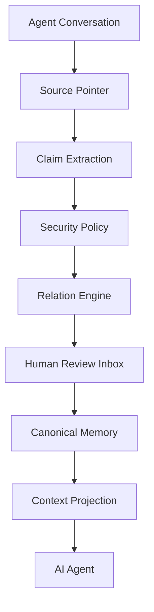

# Stellamem · 星忆

> **Give any AI a memory it can account for.**
> **Universal memory layer for any AI client — inspectable, traceable, versioned, reviewable, reversible.**
>
> **v0.4.0 (2026-11-06): the universal-client release.** From v0.3.0 to v0.4.0, the project made one directional decision: Stellamem does not serve any single host. It is a **memory governance layer any AI client can connect to** — today the production host is the DSH desktop assistant; tomorrow it can be any client that supports MCP or HTTP. See the "Vision" section below.
>
> **Current status (2026-11-08, main):** full regression **901 Python + 31 Node** passing; CI has 7 jobs (Linux / Windows / macOS × Python 3.10 / 3.12 + code quality); third-party review score **8.8/10** (final acceptance, 2026-11-05); LongMemEval 500-question independent measurement completed (see "Measured results" below). Details in the v0.4.0 section of CHANGELOG.md.
>
> **Compatibility:** projection defaults to requester `user` and scope `global`; use explicit `requesterSubject` / `activeScopes` for other namespaces/tasks. An explicit invalid namespace fails closed. Untagged topic-style legacy subjects need deliberate namespace tagging; no automatic migration runs. Generic inbox approval rejects occupied active slots and unresolved conflicts do not project. Clean user-subject pending claims auto-approve after the configured grace period (default 72h); sensitive, identity, conflicting and pre-feature backlog claims still need a human. GUI, nightly, semantic-health, pending-batch and persona-sync modules remain candidate/experimental; they are not wired into production.

Stellamem is a **local-first, auditable AI long-term memory governance layer**.
It makes an AI's long-term memory **inspectable, traceable, versioned, reviewable, and reversible** — instead of an invisible black box.

<p align="center">
  <b>✅ v0.4.0 universal-client release</b> ·
  🌐 Any MCP / HTTP client can connect ·
  🖥️ Production deployment: DSH desktop assistant ·
  🧩 Core is framework-agnostic ·
  🔒 Local-first ·
  📝 Markdown-first
</p>

<p align="center">
  <a href="README.md">中文</a> ·
  <a href="docs/QUICKSTART.md">Quick Start</a> ·
  <a href="docs/ARCHITECTURE.md">Architecture</a> ·
  <a href="docs/PHILOSOPHY.md">Philosophy</a> ·
  <a href="SECURITY.md">Security</a> ·
  <a href="docs/USE_CASES.md">Use Cases</a> ·
  <a href="CONTRIBUTING.md">Contributing</a>
</p>

---

## Vision: memory is infrastructure, not some host's accessory

Future AIs will exist for years, maybe longer. If an AI truly accompanies, works for, or serves a person long-term, it needs to answer:

- Why do I know this?
- When did the user say it?
- Is it still true?
- Has it changed since?
- What happens when two memories conflict?
- Can the user take it back?
- Should sensitive content be recalled at all?

Stellamem aims to be the **governance base layer for AI long-term memory** — not tied to any host, any model, or any vendor.

That means three things:

1. **Any client can connect.** Anything that supports MCP (stdio) or HTTP can connect to Stellamem. Today the production host is the DSH desktop assistant; tomorrow, with a different client, the memories stay and the rules stay the same. See "How any client connects" below.
2. **Memory stays on the machine.** Local by default; private memories are not sent to the cloud; extraction, compilation, and recall all happen on the machine. Cloud models are used only in public benchmarks the user explicitly agrees to — never to process private conversations.
3. **Users own their memories.** Visible, editable, rejectable, deletable, rollbackable, exportable. Every entry in the ledger can be checked.

> **Memory should be inspectable infrastructure, not invisible magic.**

---

## What problem it solves

The core problem of AI memory today is **not "AI can't remember."**

It is:

> **After AI remembers, the user doesn't know why it remembered, where it came from, whether it's out of date, whether it's a misunderstanding, or whether it can be taken back.**

A real scenario:

```text
User: I like concise answers.

A few months later:
User: Please answer technical questions in detail.

Traditional memory: may overwrite, duplicate, contradict, or fail silently.
```

How Stellamem handles it:

```text
Conversation
   ↓
Claim（structured assertion）
   ↓  scope        —— which scenario this preference belongs to
   ↓  evidence     —— what the original words were
   ↓  relation     —— how it relates to existing memories
   ↓  revision     —— which new version it produces
Memory
   ↓
Version history —— old versions are kept, rollback is possible
```

---

## How strong it is now (measured state, 2026-11-06)

The conclusion first: **on the line "remembers, remembers correctly, doesn't mix things up, doesn't leak, can be checked, changed, and taken back," Stellamem is already something worth showing.** Every claim below is backed by a number or a production record, not a slogan.

### Tests and review: 868 tests, 8.8/10

- Full regression **901 Python + 31 Node** passing (587 at v0.3.0 → 749 at v0.4.0 → 901 now, zero regressions).
- CI has 7 jobs: Linux / Windows / macOS × Python 3.10 / 3.12 + code quality. Note: on 2026-11-06, main had one failure on `windows-latest, 3.10`; it was located (a concurrent-rewrite race in `test_concurrent_rewrites_leave_complete_file`) and fixed by PR #74, and that job has been green since; see the v0.4.0 section of CHANGELOG.md.
- Third-party review score **8.8/10** (final acceptance, 2026-11-05; earlier 7.2 → 8.3 → 8.4 → 8.6 → 8.7 → 8.8). Review conclusion: fit for formal use in a single-user trusted environment; whether multi-client isolation is fully complete is waiting for the reviewer to re-check against the latest main — until that re-check passes, we do not claim "fully complete" to the outside.

### Independent measurement: LongMemEval, 500 questions, with memory 0.354 / without 0.060

LongMemEval full fourth round, completed 2026-11-08 (500 questions, main 9034cde, PR #79 narrow guard in place and PR #85 prefix fix merged; only the cheapest deepseek-flash for answering + judging, total $1.2862, $0.00257 per question; two VM restarts mid-run, resumed from checkpoints):

- **With memory 0.354 vs without memory 0.060, delta +0.294** — essentially flat vs the third round (0.350).
- **Recall@5 is 0.857, still above the 80% gate** (third round 0.870; the −0.013 is jitter — the direct arm's recall@5 is unchanged at 0.909); stuffing the raw text directly scores 0.588, so the recall gap is 5.2 points.
- Weakest two categories: single-session-assistant 0.071 (flat, evidence coverage only 0.089) and multi-session 0.124; strongest: single-session-user 0.703, knowledge update 0.569.
- On abstention questions, the memory arm still regressed (0.800 vs 1.000, exact; 0.867 by judge) — PR #79's narrow entity-match guard had no net effect at full scale: it fixed its two target questions (a96c20ee, f685340e) but two new ones flipped (0ddfec37, gpt4_93159ced), 24/30 stays 24/30; the correct-abstention gate (≥90%) is still CLOSED.
- The 32-call cap was pierced by 25 questions (5.0%); 32 extraction failures; semantic support and factual precision were not measured this time.
- Per-question tracking table: `benchmark/longmemeval/tracking_table_20261108.csv` (fourth round; the third-round table `tracking_table_20261106.csv` is still there) — of 325 wrong questions, 65% break at projection/citation (found but not cited), only 14 at retrieval. See `tracking_table.md` in the same directory.
- This is not a full-distractor official score — only comparable between arms on the same track, never to be pasted onto the official leaderboard. A re-run costs about ¥9.

Full report: `benchmark/longmemeval/` and the workspace report (see CHANGELOG).

### Production: DSH desktop assistant, 597 real records

- The DSH desktop assistant completed deployment in three stages — isolated test → real data → daily operation — and is now in daily use: health check every day at 23:30, snapshot backup every week at 23:45.
- Production database: **597 records** (user 591 / persona 6), with 33 pending records in the inbox waiting for user review. These 33 pre-date the feature, carry no auto-approval timestamp, and stay manual even after auto-approval ships.
- 2026-11-04 deployment acceptance: isolated install 21 files all green, MCP recall 3/3 hits word-for-word identical, real preference writes 3/3 read back identically.
- The production Stellamem app currently lags behind main (main is already at v0.4.0); the update task is queued — full backup with hashes and rollback before any update.

### What v0.4.0 adds (PRs #52–#70)

- **MCP subject binding (PR #64)**: bind the allowed set at launch with `--allowed-subjects` or `STELLAMEM_ALLOWED_SUBJECTS`; switching to a subject outside the set is rejected outright, recall outside the set always returns empty, writes outside the set are rejected; an invalid value fails at startup; with no binding configured, single-user trusted behavior is kept plus a startup warning. **Multi-client deployments must configure the binding.**
- **Injection gate (PR #65)**: a caller-side entity/keyword gate — unrelated questions get budget=0 and zero injection (the MCP entry returns `status: "gated"`); memory questions recall normally; if the gate itself fails, it fails open so recall is not broken.
- **Recall fallback (PR #66)**: CJK bigram signals + fact name/title intent on the JS side; intent/time fallback when the Python candidate pool is empty (marked `fallback` + weak score). The problem where natural questions with no shared bigram returned an empty candidate set is fixed; the 2026-11-06 third re-run: recall@5 rose from 0.637 to 0.870, passing the 80% gate for the first time.
- **Hit voting (PR #67)**: a hit is counted automatically only when recall is genuinely injected; manual votes are only a supplement (upvotes, half weight, no downvotes, no sinking); votes are counted per subject; voting only re-ranks records inside already-authorized recall and never bypasses isolation or confirmation gates; settlement runs through the nightly settlement.
- **4K desktop page (PRs #68 / #69)**: one page per subject, each ≤4096 bytes (over the limit is rejected, never silently truncated); rewrites leave a diff, deleting a person or covenant line needs approval; tmp + rename + lock + 14 backups. #69 fixed a Windows console Chinese-output encoding issue.
- **Daily diary, five segments + long-term (PR #70)**: one diary per subject (touchpoint / what I thought / what changed / my reply / echo), long-term only records "what changed about me"; synthesis is always local and rule-based, never calls a model, never leaves the machine; the step is skipped outright on days with no diary.
- **Nightly settlement report (PR #63)**: every night at 22:05, four numbers (per-subject, per-kind record counts; desktop page bytes; records changed that day) + two status lines (background rebuild, index rows and production DB last-write time); read-only, fails closed.
- **Background-thread rebuild (PR #55)**: when the index goes stale while running, it rebuilds in the background and reads return the old data first; measured on a real machine, `ensure_index()` dropped from about 3180 ms to 2.7–75.8 ms.
- **Concurrent-read lock (PR #57)**: `Index` gained an RLock, and API read paths hold the lock; real-machine stress test: health checks 25/25 + 50/50 with zero disconnects.
- **CI hardening (PRs #56 / #58 / #59 / #60 / #61 / #62)**: the Ubuntu 3.12 background-rebuild failure is fixed (cooldown 60→5 seconds + retry + stdout fallback); one MCP stdio test on Windows was verified to be a runner-side cause (the failure message contradicted the committed code) and is skipped on win32 with the user's approval — it still runs on Linux/macOS CI.

---

## Why Stellamem

- **Not a chat-log backup**: conversation is "raw material"; long-term memory is "the refined result". They are not the same thing.
- **Every memory has a source**: claims carry `evidence` + `provenance`; when a source cannot be verified, Stellamem **raises instead of fabricating**.
- **Scoped**: the same topic can hold different preferences in different situations, without cross-contamination.
- **Versioned**: `SUPERSEDES` updates an old value, but **the old version stays in the version chain**.
- **Conflicts don't vanish**: `CONTRADICTS` is written to the conflict log, **never silently overwritten**.
- **Secrets never enter**: credentials are blocked **before** any model call.
- **Sensitive content is never auto-written**: sensitive / identity memories go to a human review inbox.
- **Users own their memories**: visible, editable, rejectable, deletable, rollbackable.

---

## Principles

| Principle | Meaning |
|---|---|
| **Memory is not a dump** | A chat log is not long-term memory. |
| **Secret is not memory** | Credentials should never become long-term memory. |
| **Sensitive is not auto-write** | Worth keeping ≠ allowed to write automatically. |
| **Memory must have provenance** | The AI should know "why it believes this." |
| **Conflict must not disappear** | Conflicts may not be silently overwritten. |
| **Users own their memory** | Users can view / edit / reject / delete / roll back / export an AI's memory. |

> Expanded in [`docs/PHILOSOPHY.md`](docs/PHILOSOPHY.md).

---

## Core architecture



Memory unit lifecycle:

```text
Conversation → Claim → Evidence → Scope → Revision → Relation → Memory
```

> See [`docs/ARCHITECTURE.md`](docs/ARCHITECTURE.md) for details.

**One core, two subjects.** One governance core, two isolated subjects — the user's personal memory and the livestream persona memory. Their contents are never blindly merged; crossing subjects only goes through the bridge, which defaults to refusing and requires full-text human approval; only relationship facts, instructions, and work outputs may cross — private life never crosses. The number of subjects can grow, but the isolation and bridge rules do not change: any new subject goes through the same binding and approval.

---

## What Stellamem does

### Claim-based memory
Long-term memory is distilled into structured claims: `kind / subject / scope / predicate / value / confidence / evidence / provenance`.

### Provenance
Every claim carries a source pointer and a content hash. When a source cannot be resolved, Stellamem **raises instead of fabricating**.

### Scope
Different situations can hold different preferences: `global` "concise" and `technical` "detailed" coexist.

### Revision
A fact can evolve; the old revision enters the version chain instead of vanishing.

### Relation Engine
Eight relations: `NEW` / `DUPLICATE` / `REINFORCES` / `REFINES` / `COMPATIBLE` / `SUPERSEDES` / `CONTRADICTS` / `UNCERTAIN`.

### Human Review
Sensitive, identity, low-confidence, and suspicious content goes to an inbox for human `approve` / `reject` / `edit`; clean user-subject claims auto-approve via `inbox auto-approve` after the grace period (default 72h with no human action), each one written to the version chain and review log (`review_action: "auto-approve"`) and reversible with `inbox withdraw`. Tiered approval (🟢/🟡/🔴) only decides presentation and batch-operation style; the green tier's default auto-approval applies only to clean, evidence-verified, non-conflicting claims created after the feature landed — 🔴 is always one by one and always human; approving a tier requires reading the full text plus a confirmation phrase. Sensitive, identity, contradictory, unverified, and pre-feature backlog claims never auto-approve.

### Secret Gate
Secrets are deterministically detected and blocked **before any model call** — not written, not logged, not exfiltrated.

### Conflict Handling
Conflicts are written to a conflict log with both sides' evidence preserved, **never silently overwritten**.

### Transaction / Rollback
A memory write is a transaction: journaled, recoverable, rollbackable, and conflict detection never overwrites later edits. Automatic snapshot before writes + one-click rollback (rollback needs a confirmation phrase, fully audited).

### Context Projection
Only task-relevant, approved claims are injected into the agent, under a global character budget. The injection gate (PR #65) checks entities/keywords first: unrelated questions get budget=0 and zero injection.

### Recall: literal + semantic + fallback
FTS5 trigram is the main path, vectors are a bonus; intent and time questions go through kind-based recall; when the pool is empty, intent/time fallback applies (marked `fallback` + weak score, and the upper layer decides from `weak` whether to inject). When the production semantic service is offline, the weights fall back to the pure-literal mix automatically — no silent quality loss.

### Nightly settlement: memory reports its numbers once a day
Four numbers + two status lines every night (see the v0.4.0 section above). The background rebuild is silent; the settlement is the visible self-report — memory tells you every day how much it changed and whether it is healthy.

### Desktop page and diary: memory's "one sheet of paper"
One desktop page per subject, ≤4096 bytes (half people/covenant, never auto-deleted; half events), rewrites leave a diff; one five-segment diary per day, long-term only records "what changed about me". Synthesis is always local and rule-based — no model calls, nothing leaves the machine.

### Preference cards and sleep consolidation
Preference cards are summarized from approved preferences, and every statement must carry evidence; sleep consolidation digs patterns out of approved memories only, with provenance, traceable and deletable, effective only after approval by a named human, with recall weight 0.8 — below the original records.

### Token dashboard and time decay
The token dashboard is read-only: grouped statistics, token estimates, three-color budget alerts; over budget, it only suggests human review (no automatic compaction). Time decay has a 90-day half-life (configurable), only lowers ranking, never deletes data; core/pinned records never decay.

---

## What it is not

Stellamem is **not**:

- ❌ a tool to break into ChatGPT Memory
- ❌ a chat-log backup utility
- ❌ a cloud user-profiling platform
- ❌ a service that uploads all of your private data
- ❌ an accessory of some host — **it does not serve any single host; any client can connect**

---

## Status matrix

| Capability | Status |
|---|---|
| MCP server (any MCP client) | ✅ v0.4.0 · subject binding landed |
| HTTP API (Bearer Token + Scoped Token) | ✅ v0.4.0 · token-to-subject binding |
| DSH desktop assistant in production | ✅ v0.3.0 · in daily use |
| Claim compiler | ✅ |
| Relation Engine | ✅ |
| Source provenance | ✅ |
| Human Review Inbox (CLI) | ✅ |
| Secret Gate | ✅ |
| Context Projection + injection gate | ✅ v0.4.0 |
| Recall fallback (intent/time) | ✅ v0.4.0 |
| Hit voting | ✅ v0.4.0 |
| 4K desktop page + atomic writes | ✅ v0.4.0 |
| Daily diary, five segments + long-term | ✅ v0.4.0 |
| Nightly settlement report | ✅ v0.4.0 |
| Transaction / Rollback | ✅ |
| Crash recovery | ✅ |
| Local models (llama.cpp etc.) | ✅ |
| Pre-write snapshot + rollback (snapshots) | ✅ |
| Token dashboard (read-only) | ✅ |
| Time decay (recall ranking layer) | ✅ |
| selector-audit (read-only diagnostics) | ✅ |
| Skill Bank (memory skill registry) | ✅ |
| preference_summary (preference summary kind) | ✅ |
| Bridge summary rules (ADR 0004) | ✅ |
| MCP real recall (index_db_path) | ✅ v0.3.0 · verified on DSH production |
| check JSON parseability validation | ✅ v0.3.0 |
| Remote cloud models | 🚧 not supported (loopback only) |
| GUI | 🚧 |
| Sync | 🚧 |

> Status **strictly reflects the real implementation**. 🚧 means not yet built.

---

## How any client connects

Stellamem asks a client for only two things: speak MCP or HTTP, and bind its subjects at launch. Which model it is and which host it is do not matter.

### Option 1: MCP (recommended, any MCP client)

```json
{
  "mcpServers": {
    "stellamem": {
      "command": "python",
      "args": [
        "-m", "adapters.mcp.stellamem_mcp_server",
        "<workspace>", "<index.db>"
      ],
      "env": {
        "PYTHONPATH": "/path/to/stellamem",
        "STELLAMEM_ALLOWED_SUBJECTS": "user"
      }
    }
  }
}
```

- `<workspace>` is the MCP working directory, `<index.db>` is the path to `index.db` (if omitted, recall returns `wired:false`).
- **`STELLAMEM_ALLOWED_SUBJECTS` is mandatory for multi-client deployments**: bind the allowed set at launch (comma-separated; legacy aliases such as "用户" are accepted); switching to a subject outside the set is rejected outright, recall outside the set always returns empty, writes outside the set are rejected; an invalid value fails at startup, never silently runs unbounded. When neither is configured, single-user trusted behavior is kept, but a warning is printed to stderr — **without the binding configured, do not claim multi-client isolation**.
- The `--allowed-subjects user` command-line argument also works (the command line wins over the environment variable).
- `compiler` must be importable: set `PYTHONPATH` to the repository root, or launch with `-m`. Spawning the script directly without `PYTHONPATH` fails to start.

### Option 2: HTTP API

The memory service defaults to port **8791**. All read endpoints except `/v1/health` require Bearer Token authentication; Scoped Tokens are stored by SHA256 in `system/api-token-scopes.json`, bound read-only to subjects, and out-of-scope requests get a direct 403; an illegal token configuration rejects authentication outright (401) instead of falling back to "unrestricted"; `budget=0` genuinely turns recall off.

---

## Quick start

```bash
# 1. Environment check (read-only, changes nothing)
python setup.py check --offline

# 2. Dry run — see exactly what would be created or changed
python setup.py install --mem-root <MEMORY_ROOT> --dry-run

# 3. Real install (idempotent, safe to repeat; never overwrites your custom files)
python setup.py install --mem-root <MEMORY_ROOT> --config <path/to/config.json>

# 4. Offline demo with fictional data (no model needed)
python demo/run_demo.py --offline

# 5. Self-check
python compiler/memory.py doctor
```

Requirements: **Python 3.10+** (the core uses only the standard library).

> 👉 Full steps: [`docs/QUICKSTART.md`](docs/QUICKSTART.md).
> ⚠️ A local model service is required (llama.cpp / Ollama / LM Studio, etc.), and it **must be a loopback** endpoint.

### Install with an AI (no coding needed)

Stellamem has a built-in "AI install route". Hand the repository to an AI that can operate a computer and have it read [`AI_BOOTSTRAP.md`](AI_BOOTSTRAP.md). You can paste this to it:

```text
Clone this repository and read AI_BOOTSTRAP.md.
Install Stellamem in an isolated way.
Do not modify existing memory or agent configuration without asking me first.
Run the built-in checks and report whether installation succeeded.
```

---

## Security and privacy

Short version below; full version in [`SECURITY.md`](SECURITY.md).

- **Local-first** — your memory lives on your own machine by default.
- **No raw conversation duplication** — Stellamem does not keep a second full copy of the raw conversation; it stores source pointers and hashes, and the original stays in the host.
- **Secret before model** — secrets are detected and blocked before any model call.
- **Sensitive review** — sensitive and identity content needs human confirmation and is **never auto-written**.
- **Provenance or nothing** — when a source cannot be verified, Stellamem does **not fabricate**.
- **Subject isolation** — by default, only same-subject records are retrieved; cross-subject is refused by default; the bridge only passes three classes, each with full-text human approval.
- **Token permissions** — Master and Scoped tokens are separate; an illegal configuration rejects authentication instead of falling back to "unrestricted".

---

## Measured results (Benchmark)

> **Benchmark results are experimental and limited to predefined test sets.**
> The numbers below are internal version-comparison data, **not an accuracy promise**.

### LongMemEval, full 500 questions (2026-11-06, main branch before v0.4.0)

- Scale: 500 questions, 4 arms (with memory / without memory / literal match / raw text stuffed in), only deepseek-flash for answering + judging, total $1.8282 (10,779 calls, $0.00366 per question).
- **With-memory judged 0.222 vs without-memory 0.060, delta +0.162**; literal 0.122 (delta +0.062); raw text stuffed in 0.602 — claim-level projection inherently loses information; recall@5 is only 0.637 (raw text 0.909), about 27% of the key sessions never make the top 5.
- Weakest: multi-session 0.083, temporal reasoning 0.102, single-session-assistant 0.054; strongest: single-session-user 0.500, knowledge update 0.319.
- On abstention questions, the memory arm regressed (0.800 vs 1.000); the 32-call cap was pierced by 25 questions (5%).
- The acceptance gates are still CLOSED (semantic support ≥95%, recall ≥80%, correct abstention ≥90% — none met; semantic support and factual precision were not measured this time).
- This is not a full-distractor official score — only comparable between arms on the same track, never to be pasted onto the official leaderboard. The third re-run (2026-11-06, main c46a6fa) is recorded above in "Independent measurement": with memory 0.350, recall@5 0.870 (gate passed), correct abstention 0.800 (gate still closed).

### Earlier internal experiment (30 diaries, single user)

- recall ≈ 0.705 / precision ≈ 0.505; `False Write = 0` **only** means no such failure was observed on the defined adversarial samples, **not** that the real-world error rate is zero.
- Test conditions and limitations are fully documented in [`benchmark/README.md`](benchmark/README.md).

---

## Current limitations (v0.4.0's honest boundaries)

- **Whether multi-client isolation is fully complete is waiting for the reviewer to re-check against the latest main** — the mechanism has landed (PR #64 subject binding); until the re-check passes, we do not claim it is complete to the outside.
- **Recall still trails raw-text stuffing** (LongMemEval 0.222 vs 0.602) — claim-level projection inherently loses information; recall@5 0.637 is the biggest weakness right now.
- **Semantic retrieval is downgraded to literal matching in production** (port 8082 is occupied, the semantic service is offline); resolving the port or writing a formal downgrade decision is still pending.
- **About 3948 pending records in production are not activated** — batch keep / task / drop cleanup needs separate approval and must not be activated casually; 5 core identity candidates are unapproved and must not be written. Auto-approval only applies to clean claims created after the feature landed that carry a `pending_since` timestamp; it never touches this backlog.
- **Subject tagging has only been dry-run** — `namespace` has not been written into any real data; writing real data still needs a full backup, a dry-run checklist, a rollback plan, and an approver — all of them, no exceptions.
- **Persona events syncing into the user database is not implemented** — the sync candidate package is implemented (reviewed events only, approval required, all-or-nothing batches), but the actual database write is not; it needs a separately approved human task to consume.
- **The bridge GUI is implemented and hardened** — loopback binding + per-server random token + POST origin check; terminal text approval remains the fallback; the 72-hour TTL is a low-confidence guess; the keyword blacklist can be bypassed by rephrasing — the real boundary is a human reading the full text before approving.
- **The injection gate only takes effect at the MCP recall entry** — the HTTP API's default behavior is unchanged.
- **General limits**: no GUI, no sync, remote cloud models loopback-only, adapter recall is still keyword-leaning, the local 4B model has classification drift, English temporary-emotion detection is incomplete, the distillation / retention-release flow is not implemented, and it has not yet been validated by a large external user base over a long time.

These transparent items are part of the design, not hidden defects.

---

## Version history

### v0.4.0 (2026-11-06) — Universal-client release

Directional decision: not serving any single host, but a memory governance layer any AI client can connect to. PRs #52–#70: nightly settlement report, MCP subject binding, injection gate, recall fallback, Hit voting, 4K desktop page, daily diary five segments + long-term, background-thread rebuild, concurrent-read lock, CI hardening. Full regression **749 Python + 13 Node**, zero regressions; LongMemEval 500 questions completed (with memory 0.222 vs without 0.060). See `CHANGELOG.md`.

### v0.3.0 (2026-11-04) — Production release

The DSH desktop assistant completed its three-stage deployment acceptance and went into daily use. MCP real recall, check JSON validation. Full regression 587 passed.

### Security hardening after v0.3.0 (2026-11-05, PRs #42–#51)

Six rounds of external review + fixes: subject isolation (exact matching, three Scoped Token holes, SQL IN filtering, empty scope fail-closed, alias compatibility), token permissions (Bearer-token authentication, token-to-subject binding, illegal configuration rejects authentication, budget=0 genuinely turns recall off). Third-party review score 8.8/10.

---

## Roadmap

### Now (after v0.4.0)
- Multi-client isolation reviewer re-check + DSH launch-config binding
- LongMemEval re-run, to measure the real improvement from the recall fallback and injection gate
- Real token comparison (production DSH data, recall on vs off)
- Semantic retrieval: resolve the port occupation, or write a formal downgrade

### Beta
- More client onboarding docs and examples
- Semantic retrieval wired into production
- Migration stability
- Review-experience improvements (tiered approval panel)

### Future
- Desktop GUI
- Companion integrations
- Encrypted sync
- Team memory
- Enterprise governance

See [`ROADMAP.md`](ROADMAP.md).

---

## Contributing

Welcome: see [`CONTRIBUTING.md`](CONTRIBUTING.md).
> ⚠️ Any change to memory behavior **must ship a regression test**.

Do not report security issues in a public issue; use the channel in [`SECURITY.md`](SECURITY.md).

---

## License

MIT © 宇枫 · see [`LICENSE`](LICENSE)
