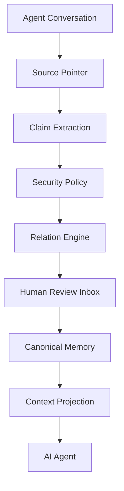

# Stellamem · 星忆

> **Give AI memory a Git.**

A **local-first, auditable memory governance layer** for AI agents.
Stellamem makes an AI's long-term memory **inspectable, traceable, versioned,
reviewable and reversible** — instead of an opaque black box.

<p align="center">
  <b>🚧 Alpha (v0.2.0-alpha)</b> ·
  🦞 First fully validated host: OpenClaw ·
  🧩 Framework-agnostic core ·
  🔒 Local-first ·
  📝 Markdown-first
</p>

<p align="center">
  <a href="README.md">中文</a> ·
  <a href="docs/QUICKSTART.md">Quick Start</a> ·
  <a href="docs/ARCHITECTURE.md">Architecture</a> ·
  <a href="SECURITY.md">Security</a> ·
  <a href="docs/USE_CASES.md">Use Cases</a> ·
  <a href="CONTRIBUTING.md">Contributing</a>
</p>

---

## What it solves

The hard problem in AI memory is **not** that "the AI can't remember".

It is that:

> **once the AI has remembered, you cannot tell why it remembered, where it came
> from, whether it is stale, whether it misread you, or whether you can undo it.**

A realistic example:

```text
User: I like concise answers.

Months later:
User: For technical questions, please answer in detail.

Plain memory: it may overwrite, duplicate, contradict, or silently go wrong.
```

What Stellamem does instead:

```text
Conversation
   ↓
Claim
   ↓  scope        — which situation this belongs to
   ↓  evidence     — what was actually said
   ↓  relation     — how it relates to existing memory
   ↓  revision     — which new version it produces
Memory
   ↓
Version history — old versions are kept and can be rolled back
```

> **Memory should be inspectable infrastructure, not invisible magic.**

---

## Why Stellamem

- **Not a chat-log backup.** Conversation is raw material; long-term memory is the
  refined result. They are not the same thing.
- **Every memory has a source.** Claims carry `evidence` + `provenance`. When a
  source cannot be verified, Stellamem **raises instead of fabricating**.
- **Scoped.** The same topic can carry different preferences in different
  situations, without cross-contamination.
- **Versioned.** `SUPERSEDES` updates a value while the old one stays in the
  version chain.
- **Conflicts don't vanish.** `CONTRADICTS` is logged; there is no silent overwrite.
- **Secrets never enter.** Credentials are blocked **before** any model call.
- **Sensitive content is never auto-written.** Sensitive and identity claims go to
  a human review inbox.
- **You own your memory.** View it, correct it, reject it, delete it, roll it back.

---

## Principles

| Principle | Meaning |
|---|---|
| **Memory is not a dump** | A chat log is not long-term memory. |
| **Secret is not memory** | Credentials should never become long-term memory. |
| **Sensitive is not auto-write** | Worth keeping ≠ allowed to write automatically. |
| **Memory must have provenance** | The AI should know *why* it believes something. |
| **Conflict must not disappear** | Conflicts may not be silently overwritten. |
| **Users own their memory** | Users can view / edit / reject / delete / roll back / export it. |

---

## Architecture



Memory unit lifecycle:

```text
Conversation → Claim → Evidence → Scope → Revision → Relation → Memory
```

> See [`docs/ARCHITECTURE.md`](docs/ARCHITECTURE.md) for details.

---

## What Stellamem does

### Claim-based memory
Long-term memory is distilled into structured claims:
`kind / subject / scope / predicate / value / confidence / evidence / provenance`.

### Provenance
Every claim carries a source pointer and a content hash. If the source cannot be
resolved, Stellamem raises rather than inventing content.

### Scope
Different situations can hold different preferences: `global` "concise" and
`technical` "detailed" coexist.

### Revision
A fact can evolve; the old revision enters the version chain instead of vanishing.

### Relation Engine
Eight relations: `NEW` / `DUPLICATE` / `REINFORCES` / `REFINES` / `COMPATIBLE` /
`SUPERSEDES` / `CONTRADICTS` / `UNCERTAIN`.

### Human Review
Sensitive, identity, low-confidence and suspicious claims go to an inbox for
`approve` / `reject` / `edit`.

### Secret Gate
Secrets are deterministically detected and blocked **before any model call** —
not written, not logged, not exfiltrated.

### Conflict Handling
Conflicts are written to a conflict log with both sides preserved. No silent
overwrite.

### Transaction / Rollback
A memory write is a transaction with a journal: recoverable and reversible, and a
rollback refuses to clobber later edits.

### Context Projection
Only task-relevant, approved claims are injected into the agent, under a global
character budget.

---

## What it is not

Stellamem is **not**:

- ❌ a tool to break into ChatGPT Memory
- ❌ a chat-log backup utility
- ❌ a cloud user-profiling platform
- ❌ a service that uploads all of your private data
- ❌ a project that only exists if you use OpenClaw

**OpenClaw is the first fully validated host, not the only host.**
The core compiler is framework-agnostic.

---

## Status matrix

| Capability | Status |
|---|---|
| OpenClaw Adapter | ✅ Alpha · isolated real-host E2E passed |
| Claim compiler | ✅ |
| Relation Engine | ✅ |
| Source provenance | ✅ |
| Human Review Inbox (CLI) | ✅ |
| Secret Gate | ✅ |
| Context Projection | ✅ |
| Transaction / Rollback | ✅ |
| Crash recovery | ✅ |
| Local models (llama.cpp etc.) | ✅ |
| Remote cloud models | 🚧 not supported (loopback only) |
| Other agent adapters | 🚧 |
| GUI | 🚧 |
| Sync | 🚧 |

> Status reflects the **real implementation** only. 🚧 means not yet built.

---

## Quick start

```bash
# 1. Environment check (read-only, changes nothing)
python setup.py check --offline

# 2. Dry run — see exactly what would be created
python setup.py install --mem-root <MEMORY_ROOT> --dry-run

# 3. Install (idempotent; never overwrites your customised files)
python setup.py install --mem-root <MEMORY_ROOT> --config <path/to/config.json>

# 4. Offline demo with fictional data (no model needed)
python demo/run_demo.py --offline

# 5. Self-check
python compiler/memory.py doctor
```

Requirements: **Python 3.10+** (the core uses only the standard library). Node is
optional and only needed for OpenClaw integration.

> 👉 Full steps: [`docs/QUICKSTART.md`](docs/QUICKSTART.md).
> ⚠️ A local model service is required (llama.cpp / Ollama / LM Studio) and it
> must be a **loopback** endpoint.

### Install with an AI coding agent

If you don't code, you can hand the repository to an AI that can operate a
computer and have it read [`AI_BOOTSTRAP.md`](AI_BOOTSTRAP.md). Paste this:

```text
Clone this repository and read AI_BOOTSTRAP.md.
Install Stellamem in an isolated way.
Do not modify existing memory or agent configuration without asking me first.
Run the built-in checks and report whether installation succeeded.
```

---

## Safety and privacy

Short version below; full version in [`SECURITY.md`](SECURITY.md).

- **Local-first** — your memory lives on your own machine by default.
- **No raw conversation duplication** — Stellamem does not keep a second full copy
  of the raw conversation. It stores source pointers and hashes; the original
  stays in the host.
- **Secret before model** — secrets are detected and blocked before any model call.
- **Sensitive review** — sensitive and identity content needs human confirmation
  and is **never auto-written**.
- **Provenance or nothing** — when a source cannot be verified, Stellamem does not
  fabricate.

---

## Benchmark

> **Benchmark results are experimental and limited to predefined test sets.**
> These are internal version-comparison numbers, not an accuracy claim.

- Samples: 30 diaries (single user)
- Metrics: recall ≈ 0.705 / precision ≈ 0.505
- `False Write = 0` **only** means no such failure was observed on the defined
  adversarial samples; it does **not** mean the real-world error rate is zero.

Full conditions and limitations: [`benchmark/README.md`](benchmark/README.md).

---

## Current limitations

- **OpenClaw is the only fully validated host** (core is framework-agnostic, but
  other host adapters are not done)
- **Remote cloud models are not supported** — the model client is loopback-only
- **Adapter retrieval is still keyword-based** — it can under-recall natural
  questions that share no token with a stored claim
- **The local 4B model shows kind-classification drift**
- **English temporary-emotion detection is incomplete**
- **Distillation / retention release is not implemented**
- **No GUI yet**
- **Not yet validated by a large external user base over time**

This transparency is part of the design, not a hidden defect.

---

## Roadmap

### Alpha (now)
- reliability, retrieval quality, external testing

### Beta
- more host adapters, semantic retrieval, migration stability, review UX

### Future
- desktop GUI, companion integrations, MCP, encrypted sync, team memory,
  enterprise governance

See [`ROADMAP.md`](ROADMAP.md).

---

## Contributing

See [`CONTRIBUTING.md`](CONTRIBUTING.md).
> ⚠️ Any change to memory behaviour **must ship a regression test**.

Please do not report security issues in a public issue; use the channel in
[`SECURITY.md`](SECURITY.md).

---

## Vision

Future AI systems will exist for years. If an AI is to genuinely accompany, work
with, or serve a person over time, it must be able to answer:

- Why do I know this?
- When did the user say it?
- Is it still true?
- Has it changed since?
- What if two memories conflict?
- Can the user undo it?
- Should sensitive content be recalled at all?

Stellamem aims to become **the governance foundation for long-term AI memory**.

**OpenClaw is the first stop, not the destination.**

---

## License

MIT © 宇枫 · see [`LICENSE`](LICENSE)
