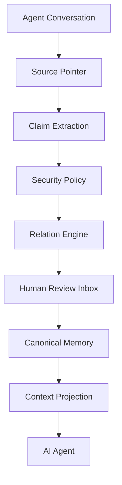

# Stellamem · 星忆

> **给任何 AI 一个能查账的记忆。**
> **Universal memory layer for any AI client — inspectable, traceable, versioned, reviewable, reversible.**
>
> **v0.4.0（2026-11-06）：通用客户端版本。** 从 v0.3.0 到 v0.4.0，项目做了一次方向上的收束：Stellamem 不为某一个宿主服务，它是**任何 AI 客户端都能接的记忆治理层**——今天的生产宿主是 DSH 桌面助手，明天可以是任何支持 MCP 或 HTTP 的客户端。愿景见下方“愿景”一节。
>
> **当前状态（2026-11-06，main）：** 全量回归 **771 Python + 13 Node** 通过；CI 7 个 job（Linux / Windows / macOS × Python 3.10 / 3.12 + 代码质量）；第三方审查评分 **8.8/10**（2026-11-05 最终验收）；LongMemEval 500 题独立测量已跑完（见下方“量化效果”）。详见 CHANGELOG.md 的 v0.4.0 一节。
>
> **Compatibility:** projection defaults to requester `user` and scope `global`; use explicit `requesterSubject` / `activeScopes` for other namespaces/tasks. An explicit invalid namespace fails closed. Untagged topic-style legacy subjects need deliberate namespace tagging; no automatic migration runs. Generic inbox approval rejects occupied active slots and unresolved conflicts do not project. GUI, nightly, semantic-health, pending-batch and persona-sync modules remain candidate/experimental; they are not wired into production.

Stellamem 是一个**本地优先、可审计的 AI 长期记忆治理层**。
它让 AI 的长期记忆可以被**查看、溯源、版本化、复核、回滚** —— 而不是变成一个不可见的黑箱。

<p align="center">
  <b>✅ v0.4.0 通用客户端版本</b> ·
  🌐 任何 MCP / HTTP 客户端都能接 ·
  🖥️ 生产部署：DSH 桌面助手 ·
  🧩 核心与框架无关 ·
  🔒 本地优先 ·
  📝 Markdown 优先
</p>

<p align="center">
  <a href="README.en.md">English</a> ·
  <a href="docs/QUICKSTART.md">Quick Start</a> ·
  <a href="docs/ARCHITECTURE.md">架构</a> ·
  <a href="docs/PHILOSOPHY.md">理念</a> ·
  <a href="SECURITY.md">安全</a> ·
  <a href="docs/USE_CASES.md">应用场景</a> ·
  <a href="CONTRIBUTING.md">参与贡献</a>
</p>

---

## 愿景：记忆是基础设施，不是某个宿主的附件

未来的 AI 会存在数年甚至更久。如果一个 AI 真正长期陪伴、工作或服务一个人，它就需要回答：

- 我为什么知道这件事？
- 这是用户什么时候说的？
- 现在还成立吗？
- 后来有没有改变？
- 两条记忆冲突怎么办？
- 用户能不能撤销？
- 敏感内容是否应该调用？

Stellamem 希望成为 **AI 长期记忆的治理基础层**——不绑在任何一个宿主、任何一个模型、任何一家厂商身上。

这意味着三件事：

1. **任何客户端都能接。** 只要支持 MCP（stdio）或 HTTP，就能接 Stellamem。今天跑在生产上的是 DSH 桌面助手；明天换一个客户端，记忆还在，规矩不变。接线方式见下方“任何客户端怎么接”。
2. **记忆不出本机。** 默认本地运行；私人记忆不发上云；提取、编译、召回都在本机完成。云模型只在用户明确同意的公开评测里用，从不用来处理私人对话。
3. **用户拥有自己的记忆。** 看得见、改得动、能拒绝、能删除、能回滚、能导出。记忆的每一笔账都能查。

> **Memory should be inspectable infrastructure, not invisible magic.**
> 记忆应该是可检查的基础设施，而不是看不见的魔法。

---

## 它解决什么问题

今天 AI Memory 的核心问题**不是「AI 记不住」**。

而是：

> **AI 记住之后，用户不知道它为什么记住、从哪里来的、是不是过期、是不是误解、能不能撤销。**

一个真实场景：

```text
用户：我喜欢简洁回答。

几个月后：
用户：技术问题请详细回答。

传统 Memory：可能覆盖、重复、矛盾，或者静默出错。
```

Stellamem 的处理方式：

```text
Conversation
   ↓
Claim（结构化断言）
   ↓  scope        —— 这条偏好属于哪个场景
   ↓  evidence     —— 原话是什么
   ↓  relation     —— 和已有记忆是什么关系
   ↓  revision     —— 产生哪个新版本
Memory
   ↓
Version history —— 旧版本保留，可回滚
```

---

## 现在有多强（2026-11-06 的实测状态）

先说结论：**在“记得住、记不错、不记混、不泄露、能查能改能撤回”这条线上，Stellamem 已经是能拿出来的东西。** 下面每一条都有数字或生产记录撑着，不是口号。

### 测试与审查：771 个测试，8.8/10

- 全量回归 **771 Python + 13 Node** 通过（v0.3.0 时 587 → v0.4.0 时 747 → 现在 771，零下跌）。
- CI 7 个 job：Linux / Windows / macOS × Python 3.10 / 3.12 + 代码质量。注：2026-11-06 的 main 曾在 `windows-latest, 3.10` 挂过一次，已定位（`test_concurrent_rewrites_leave_complete_file` 并发改写竞态）并由 PR #74 修掉，之后该档已绿；详见 CHANGELOG v0.4.0 一节。
- 第三方审查评分 **8.8/10**（2026-11-05 最终验收；早期 7.2 → 8.3 → 8.4 → 8.6 → 8.7 → 8.8）。评审结论：适合单人可信环境正式使用；多客户端隔离的彻底完成，正在等评审按最新 main 复核——复核通过之前，不对外宣称“已彻底完成”。

### 独立测量：LongMemEval 500 题，带记忆 0.222 / 不带 0.060

2026-11-06 跑完的 LongMemEval 全量（500 题，只用最便宜的 deepseek-flash 回答+判分，总计 $1.8282，单题 $0.00366）：

- **带记忆 0.222 vs 不带记忆 0.060，delta +0.162**——记忆确实在起作用。
- **召回@5 是 0.637**，约 27% 的关键会话没进前 5；直接塞原文是 0.602，大幅领先——claim 级投影先天会丢信息，这是已知短板，正在修（v0.4.0 的召回兜底就是针对它）。
- 最弱的三类：多会话 0.083、时间推理 0.102、单会话助手 0.054；最强的：单会话用户 0.500、知识更新 0.319。
- 拒答题上带记忆反而退步（0.800 vs 1.000）——有记忆时模型会答本该拒答的问题；v0.4.0 的注入门就是针对它。
- 32 次调用上限顶穿了 25 题（5%）；验收门（语义支撑 ≥95%、召回 ≥80%、正确拒答 ≥90%）仍是 CLOSED；语义支撑与事实精度本次没测。
- 这不是 full-distractor 官方分数，只可同跑道臂间比较，不可贴到官方榜上。重跑需先给 DeepSeek 充值（余额约 12.10 元，重跑约 11–13 元）。

完整报告：`benchmark/longmemeval/` 与工作区报告（见 CHANGELOG）。

### 生产运行：DSH 桌面助手，597 条真实记录

- DSH 桌面助手按“隔离测试 → 真实数据 → 日常运行”三阶段完成部署，已投入日常运行：每日 23:30 健康检查、每周 23:45 快照备份。
- 生产库 **597 条记录**（用户 591 / 人格 6），33 条待审在收件箱里等用户复核。
- 2026-11-04 的部署验收：隔离安装 21 文件全绿、MCP 召回 3/3 命中逐字一致、真实偏好写入 3/3 查回一致。
- 生产部署的 Stellamem 应用版本目前落后于 main（main 已到 v0.4.0），更新任务已排队——更新前全量备份、记哈希、可回滚。

### v0.4.0 这一版新加的东西（PR #52–#70）

- **MCP 主体绑定（PR #64）**：启动时用 `--allowed-subjects` 或 `STELLAMEM_ALLOWED_SUBJECTS` 绑定允许集；切到集外主体直接拒绝，集外召回一律空结果、写一律拒绝；非法值启动即报错；不配时保持单人可信行为 + 启动警告。**多客户端部署必须配绑定。**
- **注入门（PR #65）**：调用方实体/关键词门，无关问题 budget=0、零注入（MCP 入口返回 `status: "gated"`）；记忆问题正常放行；门故障时失败放行，不搞挂召回。
- **召回兜底（PR #66）**：JS 侧加 CJK 二元组信号 + fact 名字意图；Python 空池时按意图/时间兜底（标 `fallback` + 弱分）。自然问句无共同 bigram 时候选集为空的问题已修，效果待 LongMemEval 重跑量化。
- **Hit 投票（PR #67）**：召回真被注入才自动记命中；手动票只做补充（赞成票、半权重、无反对票、不下沉）；按主体分开计票；只重排已获准召回内的记录，绝不绕过隔离与确认门；结算走夜间结算。
- **4K 桌面页（PR #68 / #69）**：每主体一张、各 ≤4096 字节（超了拒绝、不静默截断）；改写留 diff，删人和约行要批；tmp + rename + 锁 + 14 份备份。#69 修了 Windows 控制台中文输出编码问题。
- **日档五段 + 长期（PR #70）**：每主体一张日档（触点 / 我的想 / 变 / 我的回 / 回声），长期只记“我变了什么”；合成一律本地规则版，不调模型、不出本机；当天没日记那步直接跳过。
- **夜间结算报数（PR #63）**：每晚 22:05 报四个数（分主体、分种类的记录数、桌面页字节数、当日变化数）+ 两行状态（后台重建、索引行数与生产库最后写入时间）；只读，失败关闭。
- **后台线程重建（PR #55）**：运行中索引变旧时后台重建、读请求先返回旧数据；真机实测 `ensure_index()` 从约 3180 ms 降至 2.7–75.8 ms。
- **并发读锁（PR #57）**：`Index` 加 RLock，API 读路径持锁；真机压测健康检查 25/25 + 50/50 零断开。
- **CI 加固（PR #56 / #58 / #59 / #60 / #61 / #62）**：Ubuntu 3.12 后台重建失败已修（冷却 60→5 秒 + 重试 + stdout 兜底）；Windows 上一个 MCP stdio 测试经验证是 runner 侧原因（失败信息与提交代码矛盾），已按用户批准在 win32 上跳过该单测，Linux/macOS CI 继续跑它。

---

## Why Stellamem（为什么值得一看）

- **不是聊天记录备份**：对话是「原始素材」，长期记忆是「提炼结果」，两者不能混为一谈。
- **每条记忆都有来源**：Claim 带 `evidence` + `provenance`；来源无法验证时**报错，不伪造**。
- **支持 scope（作用域）**：同一个话题在不同场景可以有不同偏好，不互相污染。
- **支持版本演化**：`SUPERSEDES` 更新旧值，但**旧版本保留在版本链里**。
- **冲突不消失**：`CONTRADICTS` 会写进冲突日志，**不静默覆盖**。
- **密钥不进门**：密钥在任何模型调用**之前**被拦截。
- **敏感内容不自动写**：敏感 / 身份类记忆进入人工复核收件箱。
- **用户拥有自己的记忆**：看得见、改得动、能拒绝、能删除、能回滚。

---

## 核心理念

| 原则 | 含义 |
|---|---|
| **Memory is not a dump** | 聊天记录不是长期记忆。 |
| **Secret is not Memory** | 凭证永远不应成为长期记忆。 |
| **Sensitive is not Auto-write** | 值得保留 ≠ 自动允许写入。 |
| **Memory must have provenance** | AI 应该知道「为什么相信这件事」。 |
| **Conflict must not disappear** | 冲突不能静默覆盖。 |
| **Users own their memory** | 用户应能看见 / 修改 / 拒绝 / 删除 / 回滚 / 导出 AI 的记忆。 |

> 展开说明见 [`docs/PHILOSOPHY.md`](docs/PHILOSOPHY.md)。

---

## 核心架构



记忆单元的生命周期：

```text
Conversation → Claim → Evidence → Scope → Revision → Relation → Memory
```

> 完整说明见 [`docs/ARCHITECTURE.md`](docs/ARCHITECTURE.md)。

**一核两主体。** 一个治理核心，两个隔离主体——用户个人记忆与直播人格记忆，内容不盲目合并；跨主体只走桥，桥默认拒绝、全文人工批准；可过桥的仅限关系、指令、工作产出三类，私人生活等不过桥。主体数量可扩展，但隔离与桥的规矩不变：任何新主体进来，都走同一套绑定与审批。

---

## Stellamem 能做什么

### Claim-based memory（基于断言，而非整段对话）
长期记忆被提炼成结构化 Claim：`kind / subject / scope / predicate / value / confidence / evidence / provenance`。

### Provenance（来源可溯）
每条 Claim 都带来源指针与内容 hash。来源解析失败时**抛错，不编造**。

### Scope（作用域）
不同场景可以有不同偏好：`global` 的「简洁」与 `technical` 的「详细」并存。

### Revision（版本演化）
同一事实可以演进；旧版本进入版本链，不直接消失。

### Relation Engine（关系引擎）
支持 8 种关系：`NEW` / `DUPLICATE` / `REINFORCES` / `REFINES` / `COMPATIBLE` / `SUPERSEDES` / `CONTRADICTS` / `UNCERTAIN`。

### Human Review（人工复核）
敏感、身份、低置信度、可疑内容进入收件箱，人工 `approve` / `reject` / `edit`。分档批复（🟢/🟡/🔴）只决定呈现与批量操作方式，不改变“必须人批”的前提；🔴 永远逐条；按档批要先看全文加确认短语。

### Secret Gate（密钥门禁）
密钥在**任何模型调用之前**被确定性识别并阻断，不写库、不进日志、不外发。

### Conflict Handling（冲突治理）
冲突写入冲突日志并保留双方证据，**不静默覆盖**。

### Transaction / Rollback（事务与回滚）
记忆写入是一个事务：有日志、可恢复、可回滚，冲突检测不覆盖后续改动。写前自动快照 + 一键回滚（回滚需确认短语，全程审计）。

### Context Projection（上下文投影）
只向 Agent 注入**当前任务相关**的已批准 Claim，并有全局字符预算。注入门（PR #65）先过实体/关键词：无关问题 budget=0、零注入。

### 召回：字面 + 语义 + 兜底
FTS5 trigram 是主路径，向量是加分项；意图与时间问句走类型召回；空池时意图/时间兜底（标 `fallback` + 弱分，上层凭 weak 决定是否注入）。生产语义服务离线时自动退回纯字面配比，不静默降质。

### 夜间结算：记忆每天报一次数
每晚报四个数 + 两行状态（见上文 v0.4.0 一节）。后台重建是静默的，结算是看得见的自报——记忆每天告诉你它变了多少、健康不健康。

### 桌面页与日档：记忆的“一张纸”
每主体一张 ≤4096 字节的桌面页（人的一半、约的一半，永不自动删），改写留 diff；每天一张五段日档，长期只记“我变了什么”。合成一律本地规则版，不调模型、不出本机。

### 偏好卡与睡眠巩固
偏好卡从已批准的偏好里汇总，每条陈述强制带证据；睡眠巩固从已批准的记忆里挖规律（pattern），带来源、可追溯、可删除，需具名人类批准才生效，召回权重 0.8、低于原始记录。

### Token 看板与时效衰减
Token 看板只读：分组统计、token 估算、三色预算告警，超预算只给人工复核建议（不做自动压实）。时效衰减 90 天半衰期可配，只降排序不删数据，core/pinned 永不衰减。

---

## 它不是什么

Stellamem **不是**：

- ❌ ChatGPT Memory 的破解工具
- ❌ 一个聊天记录备份器
- ❌ 云端用户画像平台
- ❌ 全量上传用户私人数据的服务
- ❌ 某个宿主的附属功能——**它不为任何一个宿主服务，任何客户端都能接**

---

## 状态矩阵

| Capability | Status |
|---|---|
| MCP 服务器（任何 MCP 客户端） | ✅ v0.4.0 · 主体绑定已落地 |
| HTTP API（Bearer Token + Scoped Token） | ✅ v0.4.0 · 主体权限已绑定 |
| DSH 桌面助手正式部署 | ✅ v0.3.0 · 日常运行中 |
| Claim compiler | ✅ |
| Relation Engine | ✅ |
| Source provenance | ✅ |
| Human Review Inbox（CLI） | ✅ |
| Secret Gate | ✅ |
| Context Projection + 注入门 | ✅ v0.4.0 |
| 召回兜底（意图/时间） | ✅ v0.4.0 |
| Hit 投票 | ✅ v0.4.0 |
| 4K 桌面页 + 原子写 | ✅ v0.4.0 |
| 日档五段 + 长期 | ✅ v0.4.0 |
| 夜间结算报数 | ✅ v0.4.0 |
| Transaction / Rollback | ✅ |
| Crash recovery | ✅ |
| Local models（llama.cpp 等） | ✅ |
| 写前快照 + 回滚（snapshots） | ✅ |
| Token 看板（只读） | ✅ |
| 时效衰减（recall 排序层） | ✅ |
| selector-audit（只读诊断） | ✅ |
| Skill Bank（记忆技能注册表） | ✅ |
| preference_summary（偏好摘要 kind） | ✅ |
| 桥摘要规则（ADR 0004） | ✅ |
| MCP 真实召回（index_db_path） | ✅ v0.3.0 · DSH 生产验证 |
| check JSON 可解析性校验 | ✅ v0.3.0 |
| Remote cloud models | 🚧 暂不支持（仅环回地址） |
| GUI | 🚧 |
| Sync | 🚧 |

> 状态**严格来自真实实现**。标 🚧 的尚未实现。

---

## 任何客户端怎么接

Stellamem 对客户端只有两个要求：会说话（MCP 或 HTTP），并在启动时把主体绑死。模型是谁、宿主是谁，都不重要。

### 方式一：MCP（推荐，任何 MCP 客户端）

```json
{
  "mcpServers": {
    "stellamem": {
      "command": "python",
      "args": [
        "-m", "adapters.mcp.stellamem_mcp_server",
        "<工作区>", "<索引库.db>"
      ],
      "env": {
        "PYTHONPATH": "/path/to/stellamem",
        "STELLAMEM_ALLOWED_SUBJECTS": "user"
      }
    }
  }
}
```

- `<工作区>` 是 MCP 的工作目录，`<索引库.db>` 是 `index.db` 的路径（不传则召回返回 `wired:false`）。
- **`STELLAMEM_ALLOWED_SUBJECTS` 是多客户端部署的必选项**：启动时绑定允许集（逗号分隔，旧版别名如“用户”也认）；切到集外主体直接拒绝，集外召回一律空结果、写一律拒绝；非法值启动即报错，不静默跑成无界。两者都不配时保持单人可信行为，但启动时在 stderr 告警——**不配绑定就不得宣称具备多客户端隔离**。
- 也可用命令行参数 `--allowed-subjects user`（命令行优先于环境变量）。
- `compiler` 必须可导入：设 `PYTHONPATH` 为仓库根目录，或用 `-m` 启动。直接 spawn 脚本又不设 `PYTHONPATH` 会启动失败。

### 方式二：HTTP API

记忆服务默认端口 **8791**。除 `/v1/health` 外全部读接口要求 Bearer Token 鉴权；Scoped Token 按 SHA256 存于 `system/api-token-scopes.json`，只读绑定主体，越权请求直接 403；非法 Token 配置直接拒绝认证（401），不再返回“不受限”；`budget=0` 真正关闭召回。

---

## 快速开始

```bash
# 1. 环境自检（只读，不改任何文件）
python setup.py check --offline

# 2. 干跑，先看清会创建/修改什么
python setup.py install --mem-root <记忆根目录> --dry-run

# 3. 真安装（幂等，重复跑安全；不覆盖已有自定义文件）
python setup.py install --mem-root <记忆根目录> --config <config.json 路径>

# 4. 跑离线演示（虚构数据，无需模型）
python demo/run_demo.py --offline

# 5. 自检
python compiler/memory.py doctor
```

要求：**Python 3.10+**（核心只用标准库）。

> 👉 完整步骤见 [`docs/QUICKSTART.md`](docs/QUICKSTART.md)。
> ⚠️ 需要本地模型服务（llama.cpp / Ollama / LM Studio 等），且**只接受环回地址**。

### 用 AI 来安装（不会编程也可以）

Stellamem 内建一条「AI 安装路线」。把仓库交给一个能操作电脑的 AI，让它读
[`AI_BOOTSTRAP.md`](AI_BOOTSTRAP.md) 即可。可以直接把下面这段丢给它：

```text
Clone this repository and read AI_BOOTSTRAP.md.
Install Stellamem in an isolated way.
Do not modify existing memory or agent configuration without asking me first.
Run the built-in checks and report whether installation succeeded.
```

---

## 安全与隐私

简版如下，完整版见 [`SECURITY.md`](SECURITY.md)。

- **Local-first** —— 记忆默认保存在你自己的机器上。
- **不复制原始对话** —— Stellamem 不保存第二份完整 raw conversation；只存来源指针与 hash，原文留在宿主。
- **Secret before model** —— 密钥在发给任何模型之前被检测阻断。
- **Sensitive review** —— 敏感与身份信息需要人工确认，且**永远不自动写**。
- **Provenance or nothing** —— 来源不可验证时，**不伪造**。
- **主体隔离** —— 默认仅同主体检索，跨主体默认拒绝；桥只过三类、每条全文人工批准。
- **Token 权限** —— Master 与 Scoped 分开；非法配置拒绝认证，不回退成“不受限”。

---

## 量化效果（Benchmark）

> **Benchmark results are experimental and limited to predefined test sets.**
> 以下是内部版本比较用的实验数据，**不构成准确率承诺**。

### LongMemEval 全量 500 题（2026-11-06，v0.4.0 之前的主分支）

- 规模：500 题，4 个臂（带记忆 / 不带记忆 / 字面匹配 / 直接塞原文），只用 deepseek-flash 回答+判分，总计 $1.8282（10,779 次调用，单题 $0.00366）。
- **带记忆判分 0.222 vs 不带记忆 0.060，delta +0.162**；字面 0.122（delta +0.062）；直接塞原文 0.602——claim 级投影先天丢信息，召回@5 只有 0.637（直接塞原文 0.909），约 27% 的关键会话没进前 5。
- 最弱：多会话 0.083、时间推理 0.102、单会话助手 0.054；最强：单会话用户 0.500、知识更新 0.319。
- 拒答题带记忆臂退步（0.800 vs 1.000）；32 次调用上限顶穿 25 题（5%）。
- 验收门仍是 CLOSED（语义支撑 ≥95%、召回 ≥80%、正确拒答 ≥90% 均未达到；语义支撑与事实精度本次没测）。
- 这不是 full-distractor 官方分数，只可同跑道臂间比较，不可贴到官方榜上。v0.4.0 的召回兜底与注入门修完后，重跑待 DeepSeek 充值（余额约 12.10 元，重跑约 11–13 元）。

### 早期内部实验（30 篇日记，单一用户）

- recall ≈ 0.705 / precision ≈ 0.505；`False Write = 0` **仅**表示在已定义的对抗样本中未观察到该类失败，**不代表真实环境零错误**。
- 测试条件与局限已完整记录，详见 [`benchmark/README.md`](benchmark/README.md)。

---

## 当前限制（v0.4.0 的诚实边界）

- **多客户端隔离的彻底完成，正在等评审按最新 main 复核**——机制已落地（PR #64 主体绑定），复核通过之前不对外宣称已完成。
- **召回仍落后于直接塞原文**（LongMemEval 0.222 vs 0.602）——claim 级投影先天丢信息；召回@5 0.637 是当前最大短板。
- **语义检索在生产环境降级为字面匹配**（8082 端口被占用，语义服务离线）；解决端口还是书面降级，待定。
- **生产侧约 3948 条 pending 未激活**——批量 keep / task / drop 清理需单独批准，不能顺手激活；5 个核心身份候选未获批准，不得写入。
- **主体标签只到干跑**——`namespace` 尚未写入任何真实数据；写入真实数据前仍需要全量备份、干跑清单核对、回滚方案与批准人，缺一不可。
- **人格事件同步到用户库未实现**——同步候选包已实现（仅 reviewed 事件、批准要求、批量全有或全无），实际写库仍未实现，需另行人工批准的任务才能消费。
- **桥接图形界面已实现并加固**——环回绑定 + 每服务器随机令牌 + POST 来源校验，终端文本审批仍为兜底；72 小时 TTL 为低置信猜测；关键词黑名单可被改写绕过，真正边界是人工看全文批准。
- **注入门只在 MCP 召回入口生效**——HTTP API 默认行为未动。
- **通用限制**：无 GUI、无同步、远程云模型仅环回地址、Adapter 召回仍偏关键词、本地 4B 模型存在分类漂移、英文临时情绪检测不完整、蒸馏 / 保留释放流程尚未实现、尚未经过大规模外部用户长期验证。

这些透明项是设计的一部分，不是缺陷隐瞒。

---

## 版本历史

### v0.4.0（2026-11-06）—— 通用客户端版本

方向收束：不为某一个宿主服务，做任何 AI 客户端都能接的记忆治理层。PR #52–#70：夜间结算报数、MCP 主体绑定、注入门、召回兜底、Hit 投票、4K 桌面页、日档五段 + 长期、后台线程重建、并发读锁、CI 加固。全量回归 **771 Python + 13 Node**，零下跌；LongMemEval 500 题跑完（带记忆 0.222 vs 不带 0.060）。详见 `CHANGELOG.md`。

### v0.3.0（2026-11-04）—— 正式落地版本

DSH 桌面助手完成三阶段部署验收并投入日常运行。MCP 真实召回、check JSON 校验。全量回归 587 passed。

### v0.3.0 之后的安全加固（2026-11-05，PR #42–#51）

六轮外部审查 + 修复：主体隔离（精确匹配、Scoped Token 三漏洞、SQL IN 过滤、空权限 fail-closed、别名兼容）、Token 权限（Bearer 鉴权、Token-主体绑定、非法配置拒绝认证、budget=0 真关闭召回）。第三方审查评分 8.8/10。

---

## Roadmap

### 现在（v0.4.0 之后）
- 多客户端隔离评审复核 + DSH 启动配置绑定
- LongMemEval 重跑，量召回兜底与注入门的真实提升
- Token 真实对照（生产 DSH 数据，开召回 vs 关召回）
- 语义检索：解决端口占用，或书面降级

### Beta
- 更多客户端接入文档与示例
- 语义检索生产接线
- 迁移稳定性
- 复核体验改进（分档批复面板）

### Future
- 桌面 GUI
- Companion 集成
- 加密同步
- 团队记忆
- 企业治理

详见 [`ROADMAP.md`](ROADMAP.md)。

---

## 参与贡献

欢迎参与：见 [`CONTRIBUTING.md`](CONTRIBUTING.md)。
> ⚠️ 任何与记忆行为相关的修改，**必须附回归测试**。

安全问题请勿公开提交 Issue，按 [`SECURITY.md`](SECURITY.md) 的渠道联系。

---

## License

MIT © 宇枫 · 见 [`LICENSE`](LICENSE)
