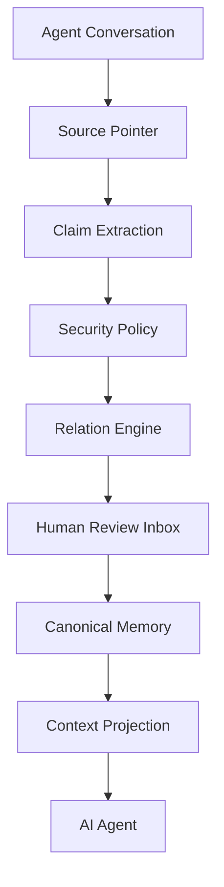

# Stellamem · 星忆

> **给 AI 记忆一个 Git。** 长期记忆要查得到来源、复核得了、撤得回去。

Stellamem 是跑在本机上的 AI 记忆系统：对话收成带证据的 Claim，经过关系判断和人工复核，才进入可被召回的记忆。记忆文件在本机；模型客户端只接受环回地址（`compiler/model_client.py`）。

它要做成的四件事是 **记得住、记不错、不记混、不泄露**。这四条是目标。下面「怎样算完整」写哪些已经能在仓库里核对，哪些还不能。

本地运行和检索都不是差异点。MemOS 的 README（2026-11-04 对照笔记）已经描述了面向同一宿主 OpenClaw 的本地插件：SQLite + FTS5 + 向量，并自报 LoCoMo 88.83、LongMemEval 89.20。那些分数是对方自报，本仓库没有复现。**Stellamem 没有公开基准分数。** 差异在治理：Claim 带来源哈希、写前快照可回滚、人工复核收件箱、密钥门禁、主体命名空间隔离。详见下方愿景和 [`docs/ACKNOWLEDGEMENTS.md`](docs/ACKNOWLEDGEMENTS.md)。

<p align="center">
  <b>🚧 Alpha（v0.2.0-alpha）</b> ·
  🦞 首个宿主：OpenClaw ·
  🧩 核心与框架无关 ·
  🔒 记忆在本机 ·
  📝 Markdown 优先
</p>

<p align="center">
  <a href="README.en.md">English</a> ·
  <a href="docs/QUICKSTART.md">Quick Start</a> ·
  <a href="docs/ARCHITECTURE.md">架构</a> ·
  <a href="docs/PHILOSOPHY.md">理念</a> ·
  <a href="SECURITY.md">安全</a> ·
  <a href="docs/USE_CASES.md">应用场景</a> ·
  <a href="CONTRIBUTING.md">参与贡献</a>
</p>
---

## 代码里已经有的设计原则

对照过当前 `main`（`e732da5`，含 PR #28 与 #29）。只写代码里的行为。

| 原则 | 代码里实际做什么 |
|---|---|
| 一个治理核心，按命名空间隔离 | `compiler/subjects.py` 的权威命名空间是三个：`user`、`persona`、`viewer`。默认同命名空间才能检索。无效或未分类的记录对谁都不可见，不回退成另一个主体。投影默认请求者是 `user`、范围是 `global`；显式的非法命名空间得到空投影（`adapters/openclaw/index.js`）。未打命名空间的旧话题要显式补标，没有自动迁移。 |
| 桥默认拒绝，全文人工批准 | `compiler/bridge.py`：跨主体默认不通过。只允许 relationship / method / result 三种结构化模板。`approve()` 要求 `confirmed_full_text=True` 和非空审批人。关键词名单只是提示。过期不能批准。72 小时是代码注释里的低置信占位，不是测出来的最优值。 |
| 只追加 | `compiler/guards.py` 与 `compiler/store.py`：`claim_id`、正文、证据、来源等不能原地改写。要改就新 revision，旧的标 superseded。`commit()` 发现内容被改会抛错。 |
| 失败即关闭 | 无效命名空间不检索；桥过期不能批准；来源指针的哈希或身份对不上则 `SourceError`，不消费这条来源（`compiler/source_reader.py`）；非环回模型地址直接拒绝；快照恢复短语不对或 SHA256 不符就拒绝。语义检索是例外：服务不可用时 `compiler/search.py` 静默退回字面检索，不打降级标记。 |
| 密钥门禁 | `compiler/pipeline.py` 在调用模型前丢掉含密钥的消息。`compiler/security.py` 把含密钥的 claim 标成 `write_policy=never`。`compiler/store.py` 入库前再拦一次，不写库。 |
| 人工复核收件箱 | `compiler/inbox.py`：pending 在 `system/memory-inbox.md`，人工 `approve` / `reject` / `edit`。这是 CLI。敏感和身份类不会在摄入时自动批准。被占住的活动槽位，通用批准会拒绝。 |

来源哈希：能对上单条消息时，provenance 带 SHA-256 `content_hash`。对不上的来源指针不会被当成那条消息用。证据不能唯一对上某条消息时，provenance 降为 chunk 级，不编造消息级哈希（`compiler/pipeline.py`）。Claim 另有 `claim_id` / `revision_id`，是槽位和取值的 SHA-256 摘要（`compiler/claim_normalizer.py`）。

写前快照：`compiler/snapshots.py` 覆盖 `stellamem-data/index.db`（SQLite `backup()`）和 `config.json`。自动调用点在 `compiler/api.py` 的索引重建和 `write_status`，不是每一条写路径。真正的 SQLite / 活动 WAL 库备份失败会抛错，不留快照，也不再 `copy2`。不是 SQLite 的文件仍可以 `copy2`。恢复必须 `confirm="RESTORE"`。SQLite 恢复先确认没有活动连接，再用 `backup()` 写回，并做 `integrity_check`、表名、`row_count`、最新记录时间核对；失败则滚回恢复前。生产环境的端到端回执仍未核验。

`compiler/nightly.py`、`compiler/semantic_health.py`、`compiler/pending_batch.py`、`compiler/persona_sync.py`、`compiler/bridge_gui.py` 在本仓库里只被测试导入，没有接到安装后的生产调用链上。

## 愿景

给 AI 记忆一份类似 Git 的历史：每一条都能回答从哪来、现在还算不算数、跟别的记忆冲突时留着双方、人能不能撤。比的是治理，不是谁记得多，也不是谁更「本地」或谁的检索更全。MemOS 的 README 已经在讲本地 OpenClaw 插件和混合检索，并且有自报分数。Stellamem 要补上的是可追溯、可复核、可撤回，再用公开评测把「记得对、不记混」量出来。目前没有公开跑分。评估顺序见 [`docs/evaluation-plan.md`](docs/evaluation-plan.md)，全部是计划，未跑。

对照笔记写于 2026-11-04，不是本仓库实测。README 没写的，写「README 未提及」，不等于对方没有。

| | Mem0 | Graphiti | Letta | MemOS | Stellamem（以本仓库代码为准） |
|---|---|---|---|---|---|
| 本地运行 | README 描述库、自托管、云三种 | README 描述自托管框架 | README 描述可本地或自托管 App Server | README 描述本地 OpenClaw/Hermes 插件，SQLite+FTS5+向量 | 记忆在本机，模型客户端只允许环回。这不是差异点 |
| 来源可溯 | README 未提及 | README 写明每条事实回指来源 episode | README 未提及 | README 未提及 | 单条消息对得上时，provenance 带内容哈希 |
| 时间 / 版本 | 笔记记录 `mem0/memory/main.py` 有 `history(memory_id)` | README 写双时间、保留时间历史 | README 未提及 | README 未提及 | `valid_to` / `expired_at`、`as_of`、`SUPERSEDES` 版本链。这是本仓库自己的代码 |
| 回滚 | README 未提及 | README 未提及 | README 未提及 | README 未提及 | 写前快照 + 确认短语；另有事务。生产端到端未验证 |
| 人工复核 | README 未提及 | README 未提及 | README 未提及 | README 未提及 | 收件箱 `approve` / `reject` / `edit` |
| 密钥 / 隔离 | README 未提及 | README 未提及 | README 未提及 | README 未提及 | 模型调用前的密钥门禁；三个命名空间；桥默认拒绝 |
| 公开跑分 | 笔记写 memory-benchmarks 覆盖 LongMemEval / LoCoMo / BEAM，且 README 写明只支持 Mem0 后端 | 笔记未记录公开分 | 笔记未记录公开分 | README 自报 LoCoMo 88.83、LongMemEval 89.20 | **没有公开基准分数** |

## 怎样算完整（9 分验收线）

9 分是「完整、可靠、在生产环境经得起查」。10 分是下一节的候选 A，还没做。下表只根据仓库和公开 CI，不把生产环境说成已经验过。

| 条款 | 状态 | 依据 |
|---|---|---|
| #26 已合入 main | 已完成 | 合并提交 `83e4e9a` |
| #26 合入后 CI 全绿 | 未完成 | main 上 Engineering checks [run 41667719093](https://github.com/yufeng000036-jpg/stellamem/actions/runs/41667719093) 结论是 failure：`tests (macos-latest, 3.10)` 为 cancelled，其余已结束的 job 为 success。不能写成全绿 |
| #15 已合入 main | 已完成 | `803df0d`。当前 main 是 `e732da5`，其上还有 #28 与 #29 |
| #15 合入后 CI 全绿 | 未完成 | 写本文时 main push [run 41670486088](https://github.com/yufeng000036-jpg/stellamem/actions/runs/41670486088) 仍未结束（总状态 queued）。未全绿 |
| 4 项修复在真实数据上验证 | 未验证/待生产核验 | 四项修复的代码已在 main（WAL 在线备份、偏好卡 `pref_subject`、提取前选 skill、budget 之后才计使用次数）。仓库里没有真实记忆库上的核验记录 |
| 快照→回滚端到端跑通 | 未验证/待生产核验 | 单测覆盖 `auto_snapshot` / `restore_snapshot`。仓库里没有生产环境端到端回执 |
| gate 在运行中的 ClawX 生效 | 未接线；效果未验证/待生产核验 | `InjectionGate` 只在 `compiler/gate.py` 和测试里出现。`benchmark/live_verify.py` 会查看名为 ClawX 的进程，本仓库没有「门已在该进程生效」的回执 |
| pending 激活 | 未验证/待生产核验 | 收件箱批准路径在代码里。仓库不含生产库 |
| sleep_purify 命名空间剥离 bug | 仓库内未见该修复；生产效果未验证/待生产核验 | `compiler/sleep_purify.py` 没有命名空间剥离修复 |
| 生产索引 SHA 差异查清 | 未验证/待生产核验 | 仓库里没有生产索引的对照记录 |
| restore + rebuild 回执核验 | 未验证/待生产核验 | 仓库里没有这份生产回执 |
| 语义检索恢复，或书面定下降级方案 | 未开始 | 服务不可用时静默退回字面检索，没有 `degraded=lexical`，也没有已采纳的书面降级决定。生产端口是否恢复：未验证/待生产核验 |
| 独立评估基线分 | 未开始 | 没有公开分数。计划见 `docs/evaluation-plan.md` |

9 分在上表离开「未完成 / 未开始 / 未验证」之前不成立。

## 合入 main 不是生产发布

PR #15 已经在 `main` 上。**代码进 main ≠ 部署到生产。** Stage E 验收仍然是 **NOT MET**。Stage F 发布门仍然 **关闭**。本树不是发布候选。完整清单在 [`docs/verification/STAGES_E_F_STATUS.md`](docs/verification/STAGES_E_F_STATUS.md)。

生产发布还缺这些证据，每一项都保持未通过：

1. 独立的人工复核金标。现有有界测量的金标是 AI 写的。
2. 开发之前就冻结的盲持出集。现有名义持出集是在已知修复之后冻结的，不是独立盲集。
3. 真正的提取 precision / recall。
4. 生成答案的证据支持。
5. 端到端来源完整度指标。
6. 整条记忆流水线的峰值内存和成本测量。
7. 相对旧日记基准、能量化的记忆质量比较。现有材料量化不了这个提升。
8. Stage E 通过。F 在 E 未通过时不能打开。
9. 生产部署记录：运行中的服务、配置和数据确实改过，并有回滚回执。#15 的合并没有这份记录。
10. D7–D13 的原始审计文本。仓库里仍然没有，这几项不能签完。`compiler/subjects.py` 里已有的「无效 namespace 不回退」只覆盖 D13 里能对上的那一种表现。
11. 在以上各项之后做出的发布候选决定。现在没有。

有界测量本身还在：300 条合成投影契约，reader Recall@1 在 80 条正例上是 1.00。那个 1.00 只度量适配器投影契约，不能用来宣称成熟度。

外部审阅者对当时的 main（`803df0d`）的主观判断是 **7.8/10**。这不是基准分数，也不是对现在的 `e732da5` 重新打的分，更不表示 Stage E 已通过或 Stage F 已打开。早先 Stage F 文稿里的 6.8/10 是更早的临时工程量规。LongMemEval v2 仍在跑，仓库里没有结果，因此没有分数。

## 外部审阅的五项（代码已修，真实数据未核验）

这五项是对 `803df0d` 的审阅。PR #28（`302128e`）与 PR #29（`e732da5`）已经把代码修进 main。回归测试用的是合成数据：`tests/test_review_round2_20261104.py`、`tests/test_pref_card_review_20261104.py`。**真实记忆库上还没有核验，需要所有者批准之后才能做。** 未验证/待生产核验。

1. **WAL 快照失败关闭。** 已修（#28）。真正的 SQLite / 活动 WAL 库在 `backup()` 失败时抛 `SnapshotError`，不留下快照，不再 `copy2`。不是 SQLite 的文件仍可以 `copy2`。恢复用 `backup()` 写回，并核对 `integrity_check`、表名、`row_count` 和最新记录时间；失败则滚回恢复前。见 `compiler/snapshots.py` 与 `tests/test_review_round2_20261104.py`。
2. **偏好卡和规律项共用一个可信主体。** 已修（#28）。`request_subject()` 优先于 `pref_subject`。两者都没有时，两条通道都返回空，不从 prompt 或卡片文本推断主体。见 `compiler/search.py`。
3. **Token 看板按规范记录取主体。** 已修（#28）。`records` 表没有 `namespace` 列。看板用 `subjects.subject_of()`：能从索引 meta 找到记忆根时读规范记录，否则用该行里已有的字段。对不上则记 `(unclassified)`。见 `compiler/token_dashboard.py`。
4. **selector-audit 对 None 失败关闭。** 已修（#28）。`subject_of()` 返回 None 时，namespace 阶段 `pass` 为 false，`namespace` 为 `unknown`，verdict 是 `blocked_by_namespace`。见 `compiler/selector_audit.py`。
5. **偏好卡先 pending，具名批准，历史只追加。** 已修（#29）。`create` / `update` 的 status 是 `pending`。`approve(subject, by)` 要求非空的具名人类。每个版本的正文、证据和状态追加进历史。`rollback(subject, version, by)` 再追加一条 pending，不改旧记录。见 `compiler/preference_summary.py` 与 `tests/test_pref_card_review_20261104.py`。

## 路线（P0–P3）

近端顺序，不是日期。没写进代码的都标计划。

- **P0** 把 9 分表里的生产核验做完并留下回执：四项修复的真实数据、快照到回滚、运行中宿主上的注入门、pending、sleep_purify 的命名空间问题、生产索引 SHA、restore+rebuild。上面五项代码缺口已经在仓库里修好，真实数据核验同样还没做，需要所有者批准。本仓库现在核验不了。
- **P1** 语义检索二选一：恢复可用，或改成显式降级。现在是静默退回，尚未采纳。以及独立评估基线，顺序见评估计划。
- **P2** 10 分方向，候选 A。计划，未实现。
- **P3** 不作为当前差异点的备选：进程内向量（fastembed + sqlite-vec）、快照之外的 WAL 持续复制（litestream）。都未实现，也未选定。

## 10 分方向（候选 A，计划，未实现）

选定方向是候选 A：把睡眠巩固做成真正的归纳，而不是把同一句话在多期里重复计数。

尚未写进代码的规则：

- 每条归纳结论必须引用支撑它的原始记忆；
- 至少 3 条证据，并且跨至少 2 个会话；
- 一律进人工复核收件箱；
- 绝不自动注入。

候选 B（偏好卡的证据链作为 10 分的一部分）仍是计划，未实现。现有偏好卡已经要求 evidence 非空，并且新建为 pending、具名批准后才 active。那是 #29 的复核，不是候选 A 的归纳。

仓库里已有的是另一件事：`compiler/sleep_consolidation.py` 的 `mine_patterns`。默认 `min_episodes=2`，把相同的 subject/predicate/value 收成 `kind=pattern` 的 pending 候选，provenance 是 episode id 列表。它不是 `pattern_claim`，不要求 3 条证据跨 2 个会话，也不保证调用方不会注入。不要把它写成候选 A 已经落地。

可参考、还没接进代码的做法：Generative Agents 的「洞见必须引用记忆编号」，Nemori 的「只蒸馏预测错的部分」。Letta 的 sleep-time compute 只说明「空闲时整理、主路径不堵住」这个方向。`compiler/nightly.py` 不是 Letta。

## 当前测试（在含 #28 / #29 的树上重跑）

- Python 3.12.3：`python -m unittest discover -s tests` → **577 passed + 42 subtests**，0 失败。这是含 PR #28 / #29 的当前树。
- Node.js 22.23.4：`node --test tests/hooks.test.mjs` → **8 passed**。
- `803df0d` 上的 563 passed + 42 subtests，以及更早的 357、372、426、472、518、528，都是当时那次测量，不是现在的 main。

本仓库不含真实记忆、生产索引、生产备份或生产配置。历史次数见 [`CHANGELOG.md`](CHANGELOG.md)。

### 现在已有的功能

**记忆治理核心（沿用 v0.1.0-alpha，并经回归验证）：**
- Claim 结构化断言：`kind / subject / scope / predicate / value / confidence / evidence / provenance`；
- 来源可溯：能对上单条消息时，provenance 带内容哈希；指针对不上就报错，不把这条来源当成已核验。不能唯一对上证据时，降为 chunk 级来源，不编造消息级哈希；
- 作用域 scope：同一话题在不同场景可有不同偏好，不互相污染；
- 版本演化：`SUPERSEDES` 更新旧值，旧版本保留在版本链里；
- 关系引擎：`NEW / DUPLICATE / REINFORCES / REFINES / COMPATIBLE / SUPERSEDES / CONTRADICTS / UNCERTAIN` 共 8 种；
- 人工复核收件箱（CLI）：敏感、身份、低置信度、可疑内容进入收件箱，人工 `approve / reject / edit`；
- 密钥门禁 Secret Gate：含密钥的消息在模型调用之前被整段排除；命中的 claim 不入库。不把「所有日志文件都已审过、必无密钥」写成额外保证；
- 冲突治理：冲突写进冲突日志并保留双方证据，不静默覆盖；
- 事务与回滚：记忆写入是事务，有日志、可恢复、可回滚；
- 上下文投影：只向 Agent 注入当前任务相关的已批准 Claim，并有全局字符预算；
- 只读体检：索引同步、冲突检测、健康检查、版本链校验（`compiler/memory.py doctor`）。

**时间与过期（生产三项版新增）：**
- 事实带 `valid_to / expired_at`，支持 `as_of()` 时间回放；
- `as_of()` 默认不再静默截断，新增 `as_of_paged()`，返回总数与是否截断。

**注入安全（改进版 + PATCH1）：**
- 注入门拦截低分非弱项：字面重叠 0 且语义低于阈值，或综合分极低时不注入；弱信号默认不注入；
- `gate_log.jsonl` 轮转：大小达到 1 MiB（1,048,576 字节）或行数达到 10000 行时轮转，最多保留 3 个旧文件；
- `snapshot()` 打包前重名检测，重复时报错而不是静默覆盖；
- append-only 内容保护：已写入内容不被静默改写。

**主体隔离与桥（改进版 + PATCH1 + PATCH2）：**
- 三个主体 `user / persona / viewer`，默认仅同主体检索，跨主体默认拒绝；
- 桥默认拒绝，仅关系、方法、结果三种结构化模板可走，全文人工批准，带来源与审批人；
- 桥批量批准失败整批不通过，单条可撤回，72 小时过期（该值为低置信猜测，需真实使用数据重定）；
- `namespace` 字段为权威主体字段，无效值 fail-closed，不回退到旧 `subject` 字段；
- 主体标签补标接口只在内存干跑，不写盘、不改现有 `subject` 字段。

**人格事件与承诺（改进版 + PATCH2）：**
- 人格适配器：事件先待确认，确认真正说出口后才可见，新增可选持久化 store；
- 人格事件持久化：SQLite sidecar 只追加事件日志，人工复核后才可导出，不自动写用户库；
  `export_pack()` 只返回 reviewed 数据；
- 承诺表：独立 SQLite sidecar，不混进记忆正文，可创建、凭证据完成、过期。

**筛查与宿主（改进版 + PATCH1）：**
- 只读 pending 筛查报告：只统计、不改状态、不激活；
- OpenClaw Adapter：隔离真实宿主的读取/注入检查通过；SQLite 会话自动采集尚未接通，完整 E2E 未验收；
- AI 自举安装：`AI_BOOTSTRAP.md` + `INSTALL.md` + `setup.py`，支持 `--dry-run`、幂等安装，
  不覆盖已有自定义文件；离线演示用虚构数据，无需模型。

**治理增强（2026-11-03，PR #17 / #18 / #20 已合入）：**
- 写前自动快照 + 一键回滚（`compiler/snapshots.py`）：写操作前自动快照，回滚需确认短语，全程审计；
- Token 看板（`compiler/token_dashboard.py`，只读）：分组统计、token 估算、三色预算告警，超预算只给人工复核建议（不做自动压实）；
- 时效衰减（`compiler/rank.py` 接入 recall）：90 天半衰期可配，只降排序不删数据，core/pinned 永不衰减；
- selector-audit（`compiler/selector_audit.py`，只读）：9 阶段诊断"这条记忆为什么没被召回"。`subject_of()` 为 None 时 verdict 是 `blocked_by_namespace`（#28）。
- Skill Bank（`compiler/skills.py`）：11 个命名、版本化、可审计的记忆技能，规则选择；
- 失败案例复盘（`compiler/designer_review.py`）：hard cases 生成 pending 提案，人工批准才生效，永不自动改；
- 桥摘要规则（ADR 0004）：过桥只传提炼摘要，原始日志永不过桥，人工检查清单；
- 偏好摘要（`compiler/preference_summary.py`）：一等记忆类型，每条陈述强制带证据，缺证据拒绝写入。新建和更新为 pending，具名批准后才 active，版本正文只追加、可回滚（#29）。真实数据未核验。

### 现在没有的功能 / 已知问题（合并前请先读）

- **D4、D5 已合并到 main（经 PR #11 累积分支；单列 PR #5 已被其覆盖，不再单独合并）：** `blocked_weak` 现在只计已标记弱信号的被拦项，新增 `blocked_low_signal / blocked_total` 计数，空结果提示按弱标记/低信号分别表述；缺 `text` 的注入项不再抛 KeyError，缺失按空文本处理。
  但 gate 当前仍无生产调用方，接线到任何生产调用方之前，调用方与回滚方式仍需单独说明，本分支不擅自接线。
- **D1、D3 已合并到 main（PR #12，合并提交 e47b4297…）：** `as_of_paged(limit=None, offset)` 不再丢弃 offset；gate 轮转阈值统一为“达到即轮转”。**D7–D12：** 仓库里没有这些编号的原始审计文本，不能宣称已修。**D13：** `compiler/subjects.py` 对无效 `namespace` 不回退到 `subject`；原始审计是否还有别的要求，仓库里对不上，不能签完。
- **主体标签只到干跑：** `compiler/legacy_tags.py` 只在内存里计划补标，不写盘。生产数据有没有 `namespace`，本仓库无法核验。写入真实数据前仍需要全量备份、干跑清单核对、回滚方案与批准人。
- **人格事件同步到用户库未实现：** 同步候选包准备已实现（仅 reviewed 事件、批准要求、批量全有或全无），`export_pack()` 只返回 reviewed 数据；实际写库仍未实现，需另行人工批准的任务才能消费。
- **桥接图形界面已实现并加固：** 环回绑定 + 每服务器随机令牌 + POST 来源校验，终端文本审批仍为兜底；72 小时 TTL 为低置信猜测；关键词黑名单可被改写绕过，真正边界是人工看全文批准。
- **语义检索：** `compiler/semantic.py` 走 llama.cpp 的 `/v1/embeddings`，默认 `127.0.0.1:8082`。服务不可用时 `compiler/search.py` 静默退回字面检索，不写 `degraded` 标记。健康检查、向量缓存、重排在 `compiler/semantic_health.py`，该模块没有生产调用方。生产端口是否恢复：未验证/待生产核验。
- **生产侧 pending：** 仓库不含生产库，不能证明 pending 已激活或仍未激活。交接材料里出现过的条数不在这里当作当前已核对的数字。批量 keep / task / drop 仍需单独批准。
- **通用 Alpha 限制：** 没有桌面产品 GUI（桥接审批有环回页面 `compiler/bridge_gui.py`，未接到生产调用链）；无同步；远程云模型仅环回地址；其他宿主适配未完成；Adapter 召回仍偏关键词；本地 4B 模型存在分类漂移；英文临时情绪检测不完整；`schema.md` 里的 distill 归档流程没有对应的 `distill.py`。文本版 `compiler/sleep_consolidation.py` 已在 main（PR #25），那不是 distill，也不是候选 A。尚未经过大规模外部用户长期验证。
- **量化口径：** 没有公开基准分数。旧的 30 篇日记 recall ≈ 0.705 / precision ≈ 0.505 已被 `benchmark/README.md` 标明无法用现行匹配器复现，不能当作当前成绩。`False Write = 0` 仅表示在已定义的对抗样本中未观察到该类失败。


## 它解决什么问题

今天 AI Memory 的核心问题**不是「AI 记不住」**。

而是：

> **AI 记住之后，用户不知道它为什么记住、从哪里来的、是不是过期、是不是误解、能不能撤销。**

一个真实场景：

```text
用户：我喜欢简洁回答。

几个月后：
用户：技术问题请详细回答。

传统 Memory：可能覆盖、重复、矛盾，或者静默出错。
```

Stellamem 的处理方式：

```text
Conversation
   ↓
Claim（结构化断言）
   ↓  scope        —— 这条偏好属于哪个场景
   ↓  evidence     —— 原话是什么
   ↓  relation     —— 和已有记忆是什么关系
   ↓  revision     —— 产生哪个新版本
Memory
   ↓
Version history —— 旧版本保留，可回滚
```

> **Memory should be inspectable infrastructure, not invisible magic.**
> 记忆应该是可检查的基础设施，而不是看不见的魔法。

---

## Why Stellamem（为什么值得一看）

- **不是聊天记录备份**：对话是「原始素材」，长期记忆是「提炼结果」，两者不能混为一谈。
- **每条记忆都有来源**：Claim 带 `evidence` + `provenance`；来源无法验证时**报错，不伪造**。
- **支持 scope（作用域）**：同一个话题在不同场景可以有不同偏好，不互相污染。
- **支持版本演化**：`SUPERSEDES` 更新旧值，但**旧版本保留在版本链里**。
- **冲突不消失**：`CONTRADICTS` 会写进冲突日志，**不静默覆盖**。
- **密钥不进门**：密钥在任何模型调用**之前**被拦截。
- **敏感内容不自动写**：敏感 / 身份类记忆进入人工复核收件箱。
- **用户拥有自己的记忆**：看得见、改得动、能拒绝、能删除、能回滚。

---

## 核心理念

| 原则 | 含义 |
|---|---|
| **Memory is not a dump** | 聊天记录不是长期记忆。 |
| **Secret is not Memory** | 凭证永远不应成为长期记忆。 |
| **Sensitive is not Auto-write** | 值得保留 ≠ 自动允许写入。 |
| **Memory must have provenance** | AI 应该知道「为什么相信这件事」。 |
| **Conflict must not disappear** | 冲突不能静默覆盖。 |
| **Users own their memory** | 用户应能看见 / 修改 / 拒绝 / 删除 / 回滚 / 导出 AI 的记忆。 |

> 展开说明见 [`docs/PHILOSOPHY.md`](docs/PHILOSOPHY.md)。

---

## 核心架构



记忆单元的生命周期：

```text
Conversation → Claim → Evidence → Scope → Revision → Relation → Memory
```

> 完整说明见 [`docs/ARCHITECTURE.md`](docs/ARCHITECTURE.md)。

---

## Stellamem 能做什么

### Claim-based memory（基于断言，而非整段对话）
长期记忆被提炼成结构化 Claim：`kind / subject / scope / predicate / value / confidence / evidence / provenance`。

### Provenance（来源可溯）
每条 Claim 都带来源指针与内容 hash。来源解析失败时**抛错，不编造**。

### Scope（作用域）
不同场景可以有不同偏好：`global` 的「简洁」与 `technical` 的「详细」并存。

### Revision（版本演化）
同一事实可以演进；旧版本进入版本链，不直接消失。

### Relation Engine（关系引擎）
支持 8 种关系：`NEW` / `DUPLICATE` / `REINFORCES` / `REFINES` / `COMPATIBLE` / `SUPERSEDES` / `CONTRADICTS` / `UNCERTAIN`。

### Human Review（人工复核）
敏感、身份、低置信度、可疑内容进入收件箱，人工 `approve` / `reject` / `edit`。

### Secret Gate（密钥门禁）
密钥在**任何模型调用之前**被确定性识别并阻断，不写库、不进日志、不外发。

### Conflict Handling（冲突治理）
冲突写入冲突日志并保留双方证据，**不静默覆盖**。

### Transaction / Rollback（事务与回滚）
记忆写入是一个事务：有日志、可恢复、可回滚，冲突检测不覆盖后续改动。

### Context Projection（上下文投影）
只向 Agent 注入**当前任务相关**的已批准 Claim，并有全局字符预算。

---

## 它不是什么

Stellamem **不是**：

- ❌ ChatGPT Memory 的破解工具
- ❌ 一个聊天记录备份器
- ❌ 云端用户画像平台
- ❌ 全量上传用户私人数据的服务
- ❌ 一个必须依赖 OpenClaw 才存在的项目

**OpenClaw 是第一个接上的宿主，不是唯一宿主。** 隔离宿主上的注入传输有证据（`docs/verification/REAL_OPENCLAW.md`）。SQLite 会话自动采集没有接通，Stage E 没有通过。核心编译器与框架无关。

---

## 状态矩阵

| Capability | Status |
|---|---|
| OpenClaw Adapter | 🚧 Alpha · 隔离宿主注入传输有证据；SQLite 自动采集未接通；Stage E 未通过 |
| Claim compiler | ✅ |
| Relation Engine | ✅ |
| Source provenance | ✅ |
| Human Review Inbox（CLI） | ✅ |
| Secret Gate | ✅ |
| Context Projection | ✅ |
| Transaction / Rollback | ✅ |
| Crash recovery | ✅ |
| Local models（llama.cpp 等） | ✅ |
| 写前快照 + 回滚（snapshots） | 代码已修（#28）：SQLite 备份失败关闭，恢复核对行数与完整性。生产端到端未验证 |
| Token 看板（只读） | 代码已修（#28）：用 `subject_of` 读规范记录。生产未验证 |
| 时效衰减（recall 排序层） | ✅ |
| selector-audit（只读诊断） | 代码已修（#28）：主体为 None 时 `blocked_by_namespace`。生产未验证 |
| Skill Bank（记忆技能注册表） | ✅ |
| preference_summary（偏好摘要 kind） | 代码已修（#29）：pending、具名批准、只追加历史、可回滚。生产未验证 |
| 桥摘要规则（ADR 0004） | ✅ |
| Remote cloud models | 🚧 暂不支持（仅环回地址） |
| Other agent adapters | 🚧 |
| GUI | 🚧 无桌面产品 GUI；桥接环回页只在测试里被导入 |
| Sync | 🚧 |

> 状态**严格来自真实实现**。标 🚧 的尚未实现。

---

## 快速开始

```bash
# 1. 环境自检（只读，不改任何文件）
python setup.py check --offline

# 2. 干跑，先看清会创建/修改什么
python setup.py install --mem-root <记忆根目录> --dry-run

# 3. 真安装（幂等，重复跑安全；不覆盖已有自定义文件）
python setup.py install --mem-root <记忆根目录> --config <config.json 路径>

# 4. 跑离线演示（虚构数据，无需模型）
python demo/run_demo.py --offline

# 5. 自检
python compiler/memory.py doctor
```

要求：**Python 3.10+**（核心只用标准库）。Node 仅在启用 OpenClaw 集成时可选。

**自动采集边界：** 安装片段默认关闭旧版 `daily-autolog`，不改变已有宿主配置。
它仅支持经过验证的 JSONL 会话来源；OpenClaw 2026.10.9 的 SQLite 会话采集尚未适配。
`setup.py check` 会明确报告这一阻碍。已批准记忆的真实宿主注入已验证，但不能据此声称新对话会自动记住。

> 👉 完整步骤见 [`docs/QUICKSTART.md`](docs/QUICKSTART.md)。
> ⚠️ 需要本地模型服务（llama.cpp / Ollama / LM Studio 等），且**只接受环回地址**。

### 用 AI 来安装（不会编程也可以）

Stellamem 内建一条「AI 安装路线」。把仓库交给一个能操作电脑的 AI，让它读
[`AI_BOOTSTRAP.md`](AI_BOOTSTRAP.md) 即可。可以直接把下面这段丢给它：

```text
Clone this repository and read AI_BOOTSTRAP.md.
Install Stellamem in an isolated way.
Do not modify existing memory or agent configuration without asking me first.
Run the built-in checks and report whether installation succeeded.
```

---

## 安全与隐私

简版如下，完整版见 [`SECURITY.md`](SECURITY.md)。

- **记忆在本机** —— 默认把记忆写在本机。这是存放方式，不是相对其他本地记忆插件的差异。
- **原文** —— 编译主路径保存来源指针和内容哈希，宿主里的原文仍是第一份。可选的 `compiler/raw_archive.py` 会把会话压进 `<memories_root>/_raw/`，那是第二份只追加档案。不能说系统从不保存原文副本。
- **Secret before model** —— 密钥在发给任何模型之前被检测阻断。
- **Sensitive review** —— 敏感与身份信息需要人工确认，且**永远不自动写**。
- **Provenance or nothing** —— 来源不可验证时，**不伪造**。

---

## 量化效果（Benchmark）

**没有公开基准分数。** MemOS README 自报的 LongMemEval 89.20 与 LoCoMo 88.83 不是本项目的分数。

- 旧的 30 篇日记实验曾写出 recall ≈ 0.705 / precision ≈ 0.505。`benchmark/README.md` 写明旧匹配器没有随仓发布，现行匹配器复现不了这两个数。
- `False Write = 0` 只表示在已定义的对抗样本中未观察到该类失败。
- Stage E 的 reader Recall@1 = 1.00 只覆盖 80 条合成投影契约，验收仍是 NOT MET。
- 下一步评测是计划，未跑：[`docs/evaluation-plan.md`](docs/evaluation-plan.md)。

详见 [`benchmark/README.md`](benchmark/README.md)。

---

## 当前限制（Alpha 的诚实边界）

- **OpenClaw 是唯一接过隔离宿主传输试验的宿主**（核心与框架无关；SQLite 自动采集未接通；其它宿主适配未完成）
- **远程云模型未正式支持** —— 模型客户端仅允许环回地址
- **Adapter 召回仍偏关键词** —— 可能漏召回不含同词的自然提问。语义通道不可用时静默退回字面检索
- **本地 4B 模型存在分类漂移**（kind 判定不够严谨）
- **英文临时情绪检测不完整**
- **`distill.py` 不在仓库里。** 文本版睡眠巩固已随 PR #25 合入，它不是候选 A，权重版不做
- **没有桌面产品 GUI**（桥接环回页未接到生产调用链）
- **尚未经过大规模外部用户长期验证**
- **代码在 main 上，生产发布没有做。** Stage E 未通过，Stage F 关闭

- hold 规则的干跑在仓库里。把标签写进真实数据仍未做，生产数据无法从本仓库核验。

### 仍未关闭的已知问题

- D4、D5 已合并到 main，`InjectionGate` 仍无生产调用方；
- D1、D3 已合并到 main；D7–D12 缺审计原文；D13 的无效 namespace 不回退已在代码里，其余要求对不上原文；
- 主体补标只到干跑；生产数据是否已写入，未验证/待生产核验；
- 人格事件同步的实际写库未实现。桥接环回页在仓库里，未接到生产调用链。72 小时 TTL 是低置信占位；
- 语义健康检查、缓存、重排在 `compiler/semantic_health.py`，没有生产调用方。召回在语义服务不可用时静默退回字面检索；
- 生产 pending 是否激活、核心身份候选是否写入：未验证/待生产核验。交接材料里的条数不在这里当成当前数字。

这些透明项是设计的一部分，不是缺陷隐瞒。

---

## Roadmap

近端的 P0–P3 在本文开头。下面是更长期的产品方向，字母优先级和开头的 P0–P3 不是同一张表。详见 [`ROADMAP.md`](ROADMAP.md)。

### Alpha（当前）
- 把 Stage E / F 仍缺的证据补上
- 五项代码缺口已在 #28 / #29 修好；真实数据核验仍待所有者批准
- 独立评估基线（计划，未跑）

### Beta
- 更多宿主 Adapter
- 语义检索
- 迁移稳定性
- 复核体验改进

### Future
- 桌面 GUI
- Companion 集成
- MCP
- 加密同步
- 团队记忆
- 企业治理

详见 [`ROADMAP.md`](ROADMAP.md)。

---

## 参与贡献

欢迎参与：见 [`CONTRIBUTING.md`](CONTRIBUTING.md)。
> ⚠️ 任何与记忆行为相关的修改，**必须附回归测试**。

安全问题请勿公开提交 Issue，按 [`SECURITY.md`](SECURITY.md) 的渠道联系。

---

## Vision

正文开头已经写了愿景：给 AI 记忆一个 Git，可追溯、可复核、可撤回。治理是差异点。本地运行和检索不是。

长期陪伴仍然要能回答：这件事从哪来、何时说过、现在是否还成立、后来有没有改、冲突怎么留、能不能撤、敏感内容该不该被调用。

**OpenClaw 是第一站，不是终点。** 代码在 main 上，生产发布没有做。

---

## 外部致谢

点到的外部项目、许可和「未接入 / 计划」边界在 [`docs/ACKNOWLEDGEMENTS.md`](docs/ACKNOWLEDGEMENTS.md)。评估计划在 [`docs/evaluation-plan.md`](docs/evaluation-plan.md)。

---

## License

MIT © 宇枫 · 见 [`LICENSE`](LICENSE)
