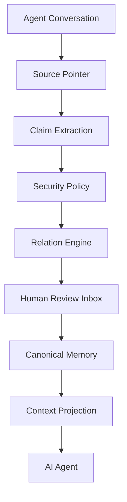

# Stellamem · 星忆

> **Give AI memory a Git.** ｜ **给 AI 记忆一个 Git。**

Stellamem 是一个**本地优先、可审计的 AI 长期记忆治理层**。
它让 AI 的长期记忆可以被**查看、溯源、版本化、复核、回滚** —— 而不是变成一个不可见的黑箱。

<p align="center">
  <b>🚧 Alpha（v0.2.0-alpha）</b> ·
  🦞 首个一等公民宿主：OpenClaw ·
  🧩 核心与框架无关 ·
  🔒 本地优先 ·
  📝 Markdown 优先
</p>

<p align="center">
  <a href="README.en.md">English</a> ·
  <a href="docs/QUICKSTART.md">Quick Start</a> ·
  <a href="docs/ARCHITECTURE.md">架构</a> ·
  <a href="SECURITY.md">安全</a> ·
  <a href="docs/USE_CASES.md">应用场景</a> ·
  <a href="CONTRIBUTING.md">参与贡献</a>
</p>

---

## 它解决什么问题

今天 AI Memory 的核心问题**不是「AI 记不住」**。

而是：

> **AI 记住之后，用户不知道它为什么记住、从哪里来的、是不是过期、是不是误解、能不能撤销。**

一个真实场景：

```text
用户：我喜欢简洁回答。

几个月后：
用户：技术问题请详细回答。

传统 Memory：可能覆盖、重复、矛盾，或者静默出错。
```

Stellamem 的处理方式：

```text
Conversation
   ↓
Claim（结构化断言）
   ↓  scope        —— 这条偏好属于哪个场景
   ↓  evidence     —— 原话是什么
   ↓  relation     —— 和已有记忆是什么关系
   ↓  revision     —— 产生哪个新版本
Memory
   ↓
Version history —— 旧版本保留，可回滚
```

> **Memory should be inspectable infrastructure, not invisible magic.**
> 记忆应该是可检查的基础设施，而不是看不见的魔法。

---

## Why Stellamem（为什么值得一看）

- **不是聊天记录备份**：对话是「原始素材」，长期记忆是「提炼结果」，两者不能混为一谈。
- **每条记忆都有来源**：Claim 带 `evidence` + `provenance`；来源无法验证时**报错，不伪造**。
- **支持 scope（作用域）**：同一个话题在不同场景可以有不同偏好，不互相污染。
- **支持版本演化**：`SUPERSEDES` 更新旧值，但**旧版本保留在版本链里**。
- **冲突不消失**：`CONTRADICTS` 会写进冲突日志，**不静默覆盖**。
- **密钥不进门**：密钥在任何模型调用**之前**被拦截。
- **敏感内容不自动写**：敏感 / 身份类记忆进入人工复核收件箱。
- **用户拥有自己的记忆**：看得见、改得动、能拒绝、能删除、能回滚。

---

## 核心理念

| 原则 | 含义 |
|---|---|
| **Memory is not a dump** | 聊天记录不是长期记忆。 |
| **Secret is not Memory** | 凭证永远不应成为长期记忆。 |
| **Sensitive is not Auto-write** | 值得保留 ≠ 自动允许写入。 |
| **Memory must have provenance** | AI 应该知道「为什么相信这件事」。 |
| **Conflict must not disappear** | 冲突不能静默覆盖。 |
| **Users own their memory** | 用户应能看见 / 修改 / 拒绝 / 删除 / 回滚 / 导出 AI 的记忆。 |

---

## 核心架构



记忆单元的生命周期：

```text
Conversation → Claim → Evidence → Scope → Revision → Relation → Memory
```

> 完整说明见 [`docs/ARCHITECTURE.md`](docs/ARCHITECTURE.md)。

---

## Stellamem 能做什么

### Claim-based memory（基于断言，而非整段对话）
长期记忆被提炼成结构化 Claim：`kind / subject / scope / predicate / value / confidence / evidence / provenance`。

### Provenance（来源可溯）
每条 Claim 都带来源指针与内容 hash。来源解析失败时**抛错，不编造**。

### Scope（作用域）
不同场景可以有不同偏好：`global` 的「简洁」与 `technical` 的「详细」并存。

### Revision（版本演化）
同一事实可以演进；旧版本进入版本链，不直接消失。

### Relation Engine（关系引擎）
支持 8 种关系：`NEW` / `DUPLICATE` / `REINFORCES` / `REFINES` / `COMPATIBLE` / `SUPERSEDES` / `CONTRADICTS` / `UNCERTAIN`。

### Human Review（人工复核）
敏感、身份、低置信度、可疑内容进入收件箱，人工 `approve` / `reject` / `edit`。

### Secret Gate（密钥门禁）
密钥在**任何模型调用之前**被确定性识别并阻断，不写库、不进日志、不外发。

### Conflict Handling（冲突治理）
冲突写入冲突日志并保留双方证据，**不静默覆盖**。

### Transaction / Rollback（事务与回滚）
记忆写入是一个事务：有日志、可恢复、可回滚，冲突检测不覆盖后续改动。

### Context Projection（上下文投影）
只向 Agent 注入**当前任务相关**的已批准 Claim，并有全局字符预算。

---

## 它不是什么

Stellamem **不是**：

- ❌ ChatGPT Memory 的破解工具
- ❌ 一个聊天记录备份器
- ❌ 云端用户画像平台
- ❌ 全量上传用户私人数据的服务
- ❌ 一个必须依赖 OpenClaw 才存在的项目

**OpenClaw 是「第一个完整验证的宿主」，不是「唯一宿主」。**
核心编译器是框架无关的。

---

## 状态矩阵

| Capability | Status |
|---|---|
| OpenClaw Adapter | ✅ Alpha · 隔离真实宿主 E2E 通过 |
| Claim compiler | ✅ |
| Relation Engine | ✅ |
| Source provenance | ✅ |
| Human Review Inbox（CLI） | ✅ |
| Secret Gate | ✅ |
| Context Projection | ✅ |
| Transaction / Rollback | ✅ |
| Crash recovery | ✅ |
| Local models（llama.cpp 等） | ✅ |
| Remote cloud models | 🚧 暂不支持（仅环回地址） |
| Other agent adapters | 🚧 |
| GUI | 🚧 |
| Sync | 🚧 |

> 状态**严格来自真实实现**。标 🚧 的尚未实现。

---

## 快速开始

```bash
# 1. 环境自检（只读，不改任何文件）
python setup.py check --offline

# 2. 干跑，先看清会创建/修改什么
python setup.py install --mem-root <记忆根目录> --dry-run

# 3. 真安装（幂等，重复跑安全；不覆盖已有自定义文件）
python setup.py install --mem-root <记忆根目录> --config <config.json 路径>

# 4. 跑离线演示（虚构数据，无需模型）
python demo/run_demo.py --offline

# 5. 自检
python compiler/memory.py doctor
```

要求：**Python 3.10+**（核心只用标准库）。Node 仅在启用 OpenClaw 集成时可选。

> 👉 完整步骤见 [`docs/QUICKSTART.md`](docs/QUICKSTART.md)。
> ⚠️ 需要本地模型服务（llama.cpp / Ollama / LM Studio 等），且**只接受环回地址**。

### 用 AI 来安装（不会编程也可以）

Stellamem 内建一条「AI 安装路线」。把仓库交给一个能操作电脑的 AI，让它读
[`AI_BOOTSTRAP.md`](AI_BOOTSTRAP.md) 即可。可以直接把下面这段丢给它：

```text
Clone this repository and read AI_BOOTSTRAP.md.
Install Stellamem in an isolated way.
Do not modify existing memory or agent configuration without asking me first.
Run the built-in checks and report whether installation succeeded.
```

---

## 安全与隐私

简版如下，完整版见 [`SECURITY.md`](SECURITY.md)。

- **Local-first** —— 记忆默认保存在你自己的机器上。
- **不复制原始对话** —— Stellamem 不保存第二份完整 raw conversation；只存来源指针与 hash，原文留在宿主。
- **Secret before model** —— 密钥在发给任何模型之前被检测阻断。
- **Sensitive review** —— 敏感与身份信息需要人工确认，且**永远不自动写**。
- **Provenance or nothing** —— 来源不可验证时，**不伪造**。

---

## 量化效果（Benchmark）

> **Benchmark results are experimental and limited to predefined test sets.**
> 以下是内部版本比较用的实验数据，**不构成准确率承诺**。

- 样本：30 篇日记（单一用户）
- 指标：recall ≈ 0.705 / precision ≈ 0.505
- `False Write = 0` **仅**表示在已定义的对抗样本中未观察到该类失败，**不代表真实环境零错误**

测试条件与局限已完整记录，详见 [`benchmark/README.md`](benchmark/README.md)。

---

## 当前限制（Alpha 的诚实边界）

- **OpenClaw 是唯一完整 E2E 验证的宿主**（核心与框架无关，但其它宿主适配尚未完成）
- **远程云模型未正式支持** —— 模型客户端仅允许环回地址
- **Adapter 召回仍偏关键词** —— 可能漏召回不含同词的自然提问
- **本地 4B 模型存在分类漂移**（kind 判定不够严谨）
- **英文临时情绪检测不完整**
- **蒸馏 / 保留释放流程尚未实现**
- **尚无 GUI**
- **尚未经过大规模外部用户长期验证**

这些透明项是设计的一部分，不是缺陷隐瞒。

---

## Roadmap

### Alpha（当前）
- 可靠性打磨
- 召回质量
- 外部测试

### Beta
- 更多宿主 Adapter
- 语义检索
- 迁移稳定性
- 复核体验改进

### Future
- 桌面 GUI
- Companion 集成
- MCP
- 加密同步
- 团队记忆
- 企业治理

详见 [`ROADMAP.md`](ROADMAP.md)。

---

## 参与贡献

欢迎参与：见 [`CONTRIBUTING.md`](CONTRIBUTING.md)。
> ⚠️ 任何与记忆行为相关的修改，**必须附回归测试**。

安全问题请勿公开提交 Issue，按 [`SECURITY.md`](SECURITY.md) 的渠道联系。

---

## Vision

未来的 AI 会存在数年甚至更久。如果一个 AI 真正长期陪伴、工作或服务一个人，它就需要回答：

- 我为什么知道这件事？
- 这是用户什么时候说的？
- 现在还成立吗？
- 后来有没有改变？
- 两条记忆冲突怎么办？
- 用户能不能撤销？
- 敏感内容是否应该调用？

Stellamem 希望成为 **AI 长期记忆的治理基础层**。

**OpenClaw 是第一站，不是终点。**

---

## License

MIT © 宇枫 · 见 [`LICENSE`](LICENSE)
